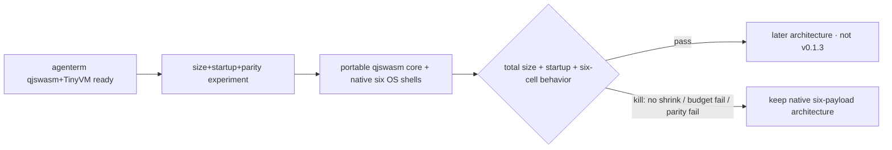
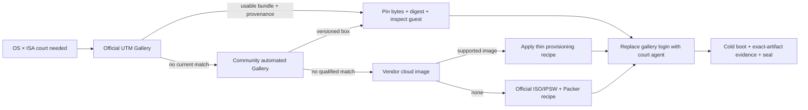

# PRD 02.27 delivery history (frozen 2026-10-21)

Extracted verbatim from `prd/PRD_02_27_con_delivery.md` on 2026-10-21 so the
live PRD stays a product/delivery specification rather than a development
history. Holds the per-release evolution record (v0.1.2 → v0.2.18), the
2026-08-23 migration records, and the 2026-08-28 UTM image-shelf discovery
memory. Frozen history: do not rewrite.

## Current release evolution

- [v] **v0.1.2 is the stable release baseline.** Tag `v0.1.2` resolves to
  source commit `e2ba35d05b1797cf770e954f35f757de327b3152`. The release owns a
  Windows x86_64 ZIP, Linux x86_64 tarball and macOS Universal tarball, each
  with a SHA-256 sidecar. Its formal workflow built all three packages, checked
  their aggregate completeness, and made a separate native Windows job
  download, hash, unpack and execute the exact packaged PE before publication.
  The repository-pinned Rust 1.97 toolchain is load-bearing evidence: release
  builders must not silently inherit a later rolling `stable` toolchain.
  This is only **4/6 cell coverage**: macOS Universal contains arm64+x86_64,
  while Windows arm64 and Linux arm64 have no v0.1.2 archive. Never backfill
  that historical Release.
- [v] **v0.1.3 released: five unsigned native archives cover all six cells.**
  Windows/Linux each publish x86_64+arm64; macOS Universal
  contains both slices. Every archive has a SHA-256 sidecar. The machine policy
  `release-policy.json` says `signing.mode=off` and `minicon_com=false`.
  Candidate consumes one clean six-payload run, executes all six native cells,
  seals exact bytes, and requires active Defender over both embedded Windows
  executables before human `v0.1.3 promote`.

  G1–G7 are green at exact source `39774ed`: one-build/six-execute run
  `33286599671`, five-archive Candidate `33286811086`, and bound reputation
  qualification `33287684429`. Defender engine `1.1.26080.3` with signatures
  `1.457.375.0` scanned both sealed Windows executables clean; their bytes were
  unchanged after scanning. The archives are 401,853-byte Windows x86_64,
  386,448-byte Windows arm64, 2,258,012-byte Linux x86_64, 2,232,167-byte
  Linux arm64, and 1,538,254-byte macOS Universal. Promotion run `33289364944`
  consumed that exact Candidate without rebuilding, published tag `v0.1.3` at
  source `39774ed`, and passed public-download hash plus native Linux/Windows
  execution. The Release is neither draft nor pre-release; `minicon.com` and
  signing remain excluded by policy.
- [v] **v0.1.4 shipped unsigned native six-cell archives through the same
  workflows.** It also proves Linux x86_64 and arm64 start in a minimal X11
  court with `libxkbcommon-x11-0` and without the `-dev` package. SignPath
  approval and release Environment variables were unavailable, so the
  committed policy remained `signing.mode=off` and `minicon_com=false`.
  Candidate selected the unsigned six-payload upstream; no missing credential
  silently chose a mode. Exact evidence is in
  `archive/v0.1.4-release-history.md`.
- [v] **v0.1.5 released raw unsigned `minicon.com` beside the five native
  archives.** One exact build supplied both representations;
  six execute-only APE GUI/control courts, native parity, a three-object
  Defender court (`minicon.com` plus both native Windows PEs), and no-rebuild
  Promotion governed the release. SignPath remained outside this release.
  Candidate run `33303093810` correctly rejected the first Linux bundle: the
  X11 bridge still needed absent `libxcb-xkb.so.1`. The repaired boundary embeds
  and stages both SONAMEs and requires the minimal-image court to prove that
  neither host package is installed.
  Exact source, runs, sizes and hashes are in
  `archive/v0.1.5-release-history.md`.

  Superseded signed-APE rehearsals, rejected Candidates and the final exact run
  ledger are preserved in `archive/v0.1.3-release-history.md`; they are not
  repeated in this living contract.


- [v] **v0.1.6 released.** Exact source `a000565`, unsigned native six-cell
  plus `minicon.com`, multiline paste fix. Ledger:
  `archive/v0.1.6-release-history.md`.

- [v] **v0.1.7 released — last unsigned line.** Aligned toolbar, greeting page
  after the final tab, explicit Linux X11 runtime boundary, screenshot-priority
  under sustained output, and replay-safe Windows control across named-pipe
  disconnects. Still unsigned (predates the signing switch-on). Ledger:
  `archive/v0.1.7-release-history.md`.

- [v] **v0.1.9 released — first dual-signed release.** The Windows executables
  and `minicon.com` are Authenticode-signed via Azure Artifact Signing, and the
  macOS build is Developer ID-signed and Apple-notarized — all as PARTNERNET
  SOFTWARE PTY LTD, with an RFC 3161 timestamp. `release-policy.json` sets both
  the Windows and macOS signing switches to `required`; missing credentials
  block the release rather than falling back to unsigned. Shipped the first UI
  wave (A+B+C+D): switchable locale, per-row close, theme engine + three themes,
  bottom status bar. Ledger: `archive/v0.1.9-release-history.md`.

- [v] **v0.1.10 released — complete UI, dual-signed.** Both signing switches
  remain `required`, and a signed, notarized, stapled macOS `.dmg` joins the
  archives. Completes the UI: two-tool header + settings panel (interface
  language, font size, theme swatches, shortcut list; `Ctrl+Shift+,`), the
  discoverable three-theme picker (`Ctrl+Shift+P`), and the grid crosshair
  (`Ctrl+Shift+G`) reading into the status bar. Ledger:
  `archive/v0.1.10-release-history.md`.

- [v] **v0.1.11 released — per-theme terminal colors, dual-signed.** Both
  signing switches stay `required`. Each theme now recolors the terminal body
  (default background/foreground, cursor, 16 ANSI colors), not just the chrome;
  the 6x6x6 cube and grayscale stay standard and explicit program colors are
  untouched. Also fixed the clipped settings-panel shortcut lines. Ledger:
  `archive/v0.1.11-release-history.md`. The stale `.github/release-notes.md`
  template was rewritten so future auto-notes state the signed, current product.

- [v] **v0.1.12 released — finish & polish, dual-signed.** Both signing switches
  stay `required`. No new surface: composer Shift+Arrow text selection, a
  theme-consistent crosshair/scrollbar, the complete/correct settings shortcut
  list, tab-title ellipsis, close-button hover + non-zero-exit coloring, header
  hover, a live zoom % readout, Escape-to-close, and the macOS/Linux
  paste-review multiline fix. From the post-0.1.11 review
  (`plan/archive/plan-0.1.12-review.md`). Ledger: `archive/v0.1.12-release-history.md`.

- [v] **v0.1.13 released — legacy-Windows CJK console fix, dual-signed.** Both
  signing switches stay `required`. Fixes garbled Chinese rendering on Windows
  without ConPTY (build < 17763, e.g. Server 2016 / 14393): the pre-ConPTY
  console agent in `agenterm-platform` keyed a double-width glyph's trailing cell
  only on the console's `COMMON_LVB_TRAILING_BYTE`, unreliable on those hosts, so
  it emitted a stray space/ASCII between CJK characters and drifted mixed
  CJK+ASCII lines. The fix derives wide-char continuation from the character's
  display width (`unicode_width`, the same oracle the vt100 parser advances on),
  keeping the LVB bit only as a secondary signal; the `agenterm-platform` pin was
  bumped to carry it. Diagnosed against a real build-14393 host and a UTM Win7
  test bed. Ledger: `archive/v0.1.13-release-history.md`.

- [v] **non-Mac macOS cross-compile from a Linux CI/cloud host, SDK-15.5 probe
  succeeded end to end.** Evidence: run
  [36024044608](https://github.com/partnernetsoftware/minicon/actions/runs/36024044608)
  (source `5c5541c`, `ubuntu-24.04`, `aarch64-apple-darwin`), every step green:
  SDK fetch, `osxcross` toolchain build (10m51s), Rust target install,
  `cargo build --release -p minicon` via the osxcross `clang` wrapper, and
  "Verify the produced binary is a real macOS Mach-O" all passed. This answers
  the question this line named: a Linux runner alone, no macOS runner at all,
  can produce a genuine macOS Mach-O for MiniCon. The SDK-15.5 switch (below)
  was the fix — the same recipe against SDK 11.3 failed on a missing symbol.
  Scope of what is proven: one target (`aarch64-apple-darwin`), one crate
  (`minicon` itself, not yet the full six-cell test/package pipeline this
  file's evidence discipline requires for a release Candidate), from
  `.github/workflows/osxcross-experiment.yml`, which is still explicitly
  experimental/manual-dispatch-only, not wired into `six-grid-cloud-build.yml`
  or any Candidate. Not yet started: the
  container pre-baking follow-on below, and wiring this path into
  `scripts/round.sh` or a release workflow.

  **`x86_64-apple-darwin` closed too (2026-09-25, background research agent,
  local Linux sandbox, nothing committed/dispatched by the agent itself):**
  same recipe as `osxcross-experiment.yml`, reproduced entirely offline —
  clone osxcross, fetch `MacOSX15.5.tar.xz` from alexey-lysiuk/macos-sdk,
  `UNATTENDED=1 ./build.sh` (~9 min on 4 cores; missing host deps on this
  sandbox's base image were `libxml2-dev`/`libssl-dev`/`uuid-dev`, not
  present on the workflow's own `ubuntu-24.04` runner presumably because it
  ships them already), then
  `CC_x86_64_apple_darwin=x86_64-apple-darwin24.5-clang cargo build --locked
  --release --target x86_64-apple-darwin -p minicon` (exit 0, 57.67s) against
  the real workspace root, not a stripped crate. Verified as a real,
  non-trivial Mach-O, not just "it compiled": `file` reports
  `Mach-O 64-bit x86_64 executable`; `otool -h` cputype 16777223 (x86_64),
  filetype EXECUTE; `nm` shows genuinely dynamically-linked
  Cocoa/AppKit/CoreFoundation symbols (`_CFRelease`, `_objc_msgSend`,
  `_objc_msgSend_stret`, `_pthread_main_np`); `otool -l` confirms the
  `__TEXT,__info_plist` section (the `-sectcreate` plist embed) is present
  and non-empty. Binary 1,564,720 bytes, sha256 `690705ea09b0...`. Also
  re-verified `aarch64-apple-darwin` in the same toolchain instance as a
  sanity check (same symbol/section evidence, `arm64`, 1,571,... bytes,
  sha256 `33e08c534d38...`), and separately built x86_64 under the exact
  `--profile release-fast` (not plain `release`) that
  `loader/rebuild-payloads.sh`'s `build_one osx-x86_64 x86_64-apple-darwin
  native` actually uses for the six-cell pack: exit 0, 22.24s, Mach-O x86_64
  confirmed again, 1,773,736 bytes. **Both osx cells are now proven
  buildable end to end from a Linux host with no macOS runner involved, for
  both the plain and the `release-fast` profile.** Not covered by this:
  signing/notarization/stapling (needs real Apple credentials regardless of
  build host, per the `sign-macos-artifacts` skill; a bare cross-linked
  Mach-O has never been claimed staplable), execution (can't run a macOS
  binary on Linux — evidence here is static: file type, arch, symbols,
  sections, not a passing test suite), and wiring this into
  `loader/rebuild-payloads.sh`, `scripts/round.sh` or any workflow (not
  attempted — a separate integration decision from the build-capability
  question this closes).

  **`minicon.com` pack step's Mac dependency is scoped down to this same
  crux, nothing else** (same agent, read-only review of
  `.github/workflows/minicon-com.yml` + `loader/rebuild-payloads.sh` +
  `loader/pack.sh` + `install-cosmocc.sh`, no code changed): `cosmocc`
  itself is already a cross-compiler with no macOS-specific step; `cargo-zigbuild`
  and `cargo-xwin` (the four non-macOS cells) are already Linux-portable and
  pinned. The **only** reason `minicon-com.yml` pins `runs-on: macos-15` is
  `rebuild-payloads.sh`'s `build_one osx-aarch64/osx-x86_64 ... native` calls
  — exactly the osxcross gap this entry tracks, not cosmocc or
  zigbuild/xwin. (`llvm-rc` via `brew install llvm` is the only other
  macOS-flavored step, solely for Windows resource compilation, with an
  obvious `apt llvm` equivalent.) So closing this entry's remaining
  integration step — swapping the two `native` `build_one` calls for the
  osxcross recipe — is in principle sufficient to run the whole
  `minicon.com` job on Linux too, but that swap itself is unattempted and is
  its own decision, not re-litigated here.

  Toolchain build time (~9-10 min from source) is unchanged and still the
  named reason for the container pre-baking follow-on below — closing the
  build-capability question does not by itself make this cheap to run
  routinely.
  History that led here (kept for the next agent, not still open):
  Owner: this section; no dedicated skill or script yet. Motivation: reduce
  reliance on "this Mac" as the only host that can produce osx-aarch64/osx-x86_64
  bytes, so a Linux CI runner could build all six cells and a Mac stays optional.
  Explored 2026-09-24 from a Linux sandbox session (evidence trail in that
  session's transcript, not yet a script in this repo):
  - `cargo check --target aarch64-apple-darwin` type-checks clean — the crate
    graph (winit/objc2/core-foundation and MiniCon's own code) has no
    Linux-side compile blocker.
  - Real linking fails on stock Linux `cc`: `-framework`/`-arch`/
    `-mmacosx-version-min` are Apple `ld64`-only flags.
  - `cargo-zigbuild` (zig's `ld64` reimplementation) accepts those flags but
    rejects minicon's `-Wl,-sectcreate,__TEXT,__info_plist,...` (used to embed
    `assets/macos-info.plist` straight into the Mach-O without a `.app`
    bundle) with `unsupported linker arg: -sectcreate`.
  - A usable macOS SDK exists in [phracker/MacOSX-SDKs](https://github.com/phracker/MacOSX-SDKs)
    up to `MacOSX11.3.sdk`, sufficient for `aarch64-apple-darwin`'s SDK-11
    floor.
  - `tpoechtrager/osxcross` (real Apple `ld64`, not a reimplementation) is the
    path past `-sectcreate`, since `ld64` supports it natively. Its `build.sh`
    **succeeds unattended on `ubuntu-24.04`**: measured 2026-09-24 on run
    `36011056592`, SDK fetch (shallow clone of phracker + `tar -cJf`) took
    3m58s and the toolchain build (cctools + ld64 from source) 10m01s. That
    ten-minute cost is why this belongs in a one-off probe or a cached image,
    never in a routine round.
  - The wrapper names osxcross produces are **not** the Rust triple: for SDK
    11.3 they are `arm64-apple-darwin20.4-clang` — `arm64`, not `aarch64`, with
    an SDK-derived `darwin20.4` suffix. A `*-cmake-clang` variant sits beside
    each one, so globbing `*-clang` matches several files and breaks
    `basename`. Match `<arch>-apple-darwin<ver>-clang` exactly and map
    `aarch64-apple-darwin` -> `arm64` yourself.
  - No macOS binary has been produced end to end from a non-Mac host yet.
    Nothing here is evidence of `[v]`.
  Next step: the probe workflow
  `.github/workflows/osxcross-experiment.yml` (manual dispatch) carries the
  recipe; the remaining unknown is only whether the link step clears
  `-sectcreate` and yields a real Mach-O. Keep that receipt (`file` output)
  before upgrading this line past `[_]`. The end goal is running the recipe on
  the Linux build host itself, so `scripts/round.sh:10`'s
  `osx-* -> this Mac` routing can drop the Mac.
  Planned follow-on (gated on the probe above landing `[v]`, not started):
  **pre-bake the osxcross toolchain into a container image** instead of
  running its from-source `build.sh` (cctools + ld64, ~10 minutes measured
  above) on every use. Same pattern `.github/workflows/six-grid-cloud-build.yml`
  already uses for the six-cell body: build the image once, publish it to
  GHCR, and have every consumer pull the image instead of rebuilding the
  toolchain.
  - Image contents: the built `/tmp/osxcross/target` tree (wrappers + cctools
    + ld64) plus the `MacOSX11.3.sdk` tarball already baked in, so a consumer
    does nothing but `docker run` or extract and export `PATH`.
    Build the image in its own manual-dispatch workflow (mirrors
    `six-grid-cloud-build.yml`'s `workflow_dispatch` + GHCR publish shape),
    not inside `osxcross-experiment.yml` or any routine round.
  - Consumers become two, both skipping the 10-minute `build.sh` step:
    (a) CI — `osxcross-experiment.yml`, and later a real macOS-cell job in
    `six-grid-cloud-build.yml`, pull the image instead of the current
    "Fetch macOS SDK" + "Build osxcross toolchain" steps;
    (b) this cloud/Linux session, once the sandbox permission to run
    fetched containers or their binaries is granted, extracts the same
    image locally so `scripts/round.sh`'s `osx-* -> this Mac` line has a
    non-Mac target to route to.
  - Rebuild trigger: the image only needs rebuilding when osxcross's own
    source or the pinned SDK version changes, not per round — this is the
    whole point, matching this file's "CI does not do routine compiling"
    rule and `AGENTS.md`'s cost-of-a-round accounting.
  - Do not build this image before the `-sectcreate` probe above is `[v]`:
    baking a toolchain that cannot actually link MiniCon's own linker flags
    would be premature investment in an unproven path.
  - **`-sectcreate` probe run (2026-09-24, run 36018434924, source `994c011`):
    the wrapper-lookup script from the earlier evidence had a bug of its
    own** -- `find -regextype posix-extended -regex '.*/(aarch64|arm64)-...'`
    matched nothing even though the same run's own failure-path `ls` showed
    `aarch64-apple-darwin20.4-clang` present, root cause not identified.
    Replaced with plain bash globbing (`.github/workflows/osxcross-experiment.yml`,
    commit `994c011`); the fixed probe found the wrapper and reached the real
    link step. **`-sectcreate` itself was accepted with no complaint** -- the
    unknown this line named is answered: real `ld64` via osxcross does take
    MiniCon's plist-embedding flag. Linking then failed on something else:
    `Undefined symbols for architecture arm64: "_proc_signal_with_audittoken"`,
    referenced from `agenterm-platform`. That symbol is not declared in the
    `MacOSX11.3.sdk` stub `libSystem.tbd` this recipe fetches from
    phracker/MacOSX-SDKs; osxcross links against the SDK's own stub library,
    not a real dyld, so a symbol newer than the pinned SDK version is
    unconditionally missing at link time regardless of what runs at runtime.
    Two ways forward were named, neither tried at the time: (a) a newer SDK,
    or (b) find where `agenterm-platform` calls the missing symbol and
    weak-link or gate that call -- out of scope for a MiniCon-side probe since
    the symbol lives in a dependency, not this crate.
  - **SDK source switched (2026-09-24): phracker/MacOSX-SDKs does not have a
    newer SDK to fetch** -- 11.3 is its newest, confirmed by listing the repo
    directly, so option (a) above needed a different source, not a different
    version from the same one.
    [alexey-lysiuk/macos-sdk](https://github.com/alexey-lysiuk/macos-sdk)
    publishes one GitHub Release per SDK version and reaches `15.5`
    (verified reachable 2026-09-24: asset `MacOSX15.5.tar.xz`, HTTP 200 via a
    signed redirect; its tarball's top-level directory is already
    `MacOSX15.5.sdk/`, just the release filename itself drops the `.sdk`).
    `.github/workflows/osxcross-experiment.yml` now fetches this SDK instead
    of phracker's 11.3. **Result (run 36024044608): SDK 15.5 resolves the
    missing-symbol failure and no new one appeared** -- the link, build, and
    Mach-O verification steps all passed. See the `[v]` entry above for the
    full evidence and remaining scope.

- [_] **Practice run, from a cloud/Linux session (2026-09-24): `scripts/round.sh`'s
  own local test-transport (not the release pipeline -- see the correction
  below) is BLOCKED at its upload step, for this session specifically.**
  Ran `scripts/round.sh lnx-x86_64` end to end from a Linux cloud sandbox to
  exercise the real workflow, not just plan it:
  - `preflight` used `df -g /System/Volumes/Data`, a macOS-only flag and path;
    it unconditionally failed (`BLOCKED`) on Linux. Fixed in `484318f` with a
    portable `df -Pk` (1 KiB blocks) computation both hosts implement.
  - After the fix, `preflight` PASSes on Linux (measured: 14G free) and the
    native `lnx-x86_64` build PASSes in 38s directly on this cloud host -- no
    cross-toolchain needed for that cell, confirming this cell at least can
    move off "this Mac" today.
  - The run then correctly BLOCKs at the GitHub-upload step (`gh release
    create`/`upload`, the transport `scripts/round.sh` uses to hand test
    executables to `local-artifact-probe.yml`). Root cause, confirmed not a
    script bug: this cloud session's `GH_TOKEN`/`GITHUB_TOKEN` does not
    authenticate the `gh` CLI against github.com (`gh auth status`: "The token
    in GH_TOKEN is invalid"). This session's GitHub access is mediated through
    the Claude GitHub App/connector, not a raw PAT usable by arbitrary shell
    tools -- by design, not misconfiguration. The available `mcp__github__`
    MCP tools were also checked and have no release-create or
    asset-upload-equivalent capability, so this step cannot currently be
    exercised from a cloud session via any available means. Per this file's
    own evidence discipline, this is `BLOCKED`, not a skipped step: a Mac
    session (or any session with real `gh` credentials) is unaffected and can
    still run the full loop. Fixing it needs either a different GitHub write
    path granted to cloud sessions, or a transport for
    `local-artifact-probe.yml` that does not depend on a release asset --
    neither attempted yet.
  - **Correction (2026-09-24, same day): this narrow finding does not extend
    to the actual release-draft upload.** `scripts/round.sh`'s tagged-prerelease
    transport is a routine-dev-round mechanism only, and it is the one thing
    genuinely blocked by this session's invalid `GH_TOKEN`. The real 0.1.24
    "cross-compile, upload to a release draft, download and test in CI" chain
    is a different, already-built path that needs none of that: `minicon-com.yml`
    / `company-signing.yml` builds all six cells natively in CI, `candidate.yml`
    packages them (`contents: read` only -- it downloads via `gh run download`
    using the job's own `github.token`), and `release.yml`'s `publish` job
    (`permissions: contents: write`, `environment: release`) runs
    `gh release create "$TAG" --draft ...` using `GH_TOKEN: ${{ github.token }}`
    -- CI's own scoped token, never this session's. Every step in that chain is
    dispatched with `workflow_dispatch`, which `mcp__github__actions_run_trigger`
    already does successfully from this session (used earlier the same day for
    `osxcross-experiment.yml`), and results are read back with
    `mcp__github__actions_get`/`get_job_logs`. So the 0.1.24 release pipeline
    itself is not blocked from this cloud session -- only `round.sh`'s separate,
    smaller-scope local test-transport is.

- [_] **horizon / dependency not ready — qjswasm portable core.**
  Owner: `prd/PRD_02_29_qjswasm_horizon.md`. After agenterm qjswasm+TinyVM is
  mature, research may move portable logic out of six native payloads into
  qjswasm; six native thin shells keep window/PTY/font/input/IPC. Size cut is
  a hypothesis, not a promise. Kill if engine+glue does not reduce the total
  package, misses startup/interaction budget, or six-cell behavior diverges.
  Never mix it into a release Candidate, version bump, or tag.




## 迁出后的交付差异（2026-08-23）

本子树随代码从 agenterm 迁入独立仓 `partnernetsoftware/minicon`。以下三条是**迁出时确实
发生变化**的事实，先记下来，不冒充仍然成立：

- [v] **unwind profile 的机制变了，要求没变。** `con-dev` / `con-release` / `con-release-fast`
  存在的唯一理由是 agenterm 的 workspace profile 是 `panic = "abort"`，必须逃出去。独立仓
  没有要逃的 aborting workspace，Cargo 默认就是 unwind，所以本仓改为直接在
  `[profile.release]` 里显式写 `panic = "unwind"`，不再要那层间接。下方 `con-*` 条目描述的
  是 agenterm 时期的实现。
- [_] ~~**体积门已在本仓重建。**~~ **已撤除（2026-08-25）。** 该门自始至终只是
  **Windows 承诺**：`tests/minicon_load_portability.rs` 整个文件是 `#![cfg(windows)]`，
  其 `shipped_binary()` 硬编码 `minicon.exe`，所以它从未在 Linux 或 macOS 上运行过一次，
  而 README 把「1 MiB 上限由测试强制」与「支持 Windows、Linux、macOS」并列，
  读起来像是可执行文件的固有属性。
  单宿主六格实测（`strip=true`）：Windows arm64 677,376 / x64 731,136、
  macOS 1,413,408 / 1,455,424、**Linux 4,846,400 / 5,732,544**——
  Linux 是上限的 5 倍以上，且已确认是代码而非符号。
  2026-08-29：`minicon.com` Linux payloads 改用 `profile.release`（thin LTO）+
  `--gc-sections`；zigbuild 的 lld 不支持 `pack-relative-relocs`。
  实测 `lnx-x86_64` 7,704,280 → 5,746,384（release-fast → release），
  `lnx-aarch64` 6,932,840 → 4,857,552。ELF 段拆分、Zip 占比与剩余杠杆见下方
  **Linux size attribution** / **Remaining mini levers**。剩余体积是
  Wayland+X11 `.text`、独立 `x11rb`、`a11y-publish`（tokio/zbus/atspi）与
  DWARF `.eh_frame`，不是漏 strip。
  一个在三个平台里两个必红的门会挡住即将开始的瘦身工作，却量不出新东西，
  所以撤门、改为在 README 直接写各平台实测字节数。
  上限若要回来，必须先明确它约束哪几个平台。
  它刻意不是警告阈值：这个数字是产品承诺，构建就应该在它上面失败。
- [-] **独立 CI 已移植，但停放中。** `ci-agenterm-con.yml` 已从 agenterm 移到本仓
  `.github/workflows/ci-minicon.yml.disabled`，`.disabled` 后缀期间不触发。重命名只能让
  GitHub 发现文件，不能自动把其中未验证的迁移命令变成发布证据；启用还要求 review 和
  首次成功运行。两处候选适配：`--profile con-release-fast` → `--profile release-fast`、
  去掉 `-p agenterm-con`（本仓单包）。**它从未在本仓跑过**，`build-std` 那几格尤其未验证。

## Historical agenterm delivery contract (migration record only)

The checked items in this section describe the last proven `agenterm-con`
implementation before extraction. They are retained to explain design choices
and measured history; they are **not commands, profiles, gates, or CI claims of
the standalone MiniCon repository**. In particular, `con-dev`,
`con-release-fast`, `con-release`, the agenterm staging merge, and agenterm's
custom-std qualification belong to migration history. The current repository
uses its ordinary Cargo profiles; `[profile.release]` explicitly preserves
`panic = "unwind"`. Any future standalone custom-std gate must be introduced
and proven here before becoming a current contract.

### Historical unwind profiles and panic containment

- [v] con owns `con-dev`, `con-release-fast` and `con-release` unwind dependency
  graphs; only the resulting executable is merged into the ordinary staging
  directory, and the workbench profiles remain aborting. Staged source, merged
  profile and `dist` bytes are identical.
- [v] this exists because native callbacks must not unwind across FFI while
  panics must still be contained: an earlier aborting artifact could not satisfy
  the claimed containment contract, since Cargo test used unwind while every
  delivery profile inherited `panic = "abort"`. A release-profile synthetic
  panic-containment test is part of the ordinary gate.
- [v] the official build pins `rust-src` and uses an explicit target plus a
  subprocess-scoped Rust 1.97 build-std boundary with `backtrace-trace-only`.
- [v] Windows startup enters through a con-owned loader boundary instead of
  `mainCRTStartup`. Rust executes XI/XC constructors, calls rustc's generated
  `main` through a one-instruction architecture trampoline, then executes XP/XT
  terminators; the PE loader remains the sole XL/TLS callback authority, so
  `lang_start`, panic containment, process command-line access and Rust cleanup
  stay intact. A test-only XCU constructor proves execution before Rust test
  main. ARM64 reaches final link with its `b main` trampoline; exact ARM64 link
  remains CI/native-toolchain evidence because the development workstation lacks
  ARM64 `vcruntime.lib`.


### UTM image shelves (observed 2026-08-28)

This is a discovery memory, not an allowlist or a claim that every image is
release-qualified. Catalog contents and download targets are mutable; an agent
must refresh the source page, resolve the concrete artifact, record its digest
and inspect the guest before importing it. A listed default password is a
bootstrap liability, never a credential to preserve in a sealed court.



**Official shelf.** Source: [UTM Gallery](https://mac.getutm.app/gallery/).
The gallery says an `Open in UTM` item can be imported directly; otherwise the
archive is extracted and its `.utm` bundle opened. It recommends native ARM64
images on Apple Silicon and permits x64 under slower emulation. Project source
and product introduction: [utmapp/UTM](https://github.com/utmapp/UTM), an
Apache-2.0 QEMU/Apple-Virtualization frontend for macOS and iOS. The current
gallery landing page exposes this inventory:

| Image | Guest ISA shown by catalog | MiniCon relevance |
|---|---|---|
| ArchLinux ARM | ARM64 | lightweight Linux ARM candidate |
| Debian 10.4, custom i3 | ARM64 | old desktop recovery/reference |
| Debian 11, LXDE | ARM64 | lightweight desktop candidate |
| Debian 11, Xfce | ARM64 | lightweight desktop candidate |
| Debian 12, Rosetta | ARM64 | Linux ARM + translated x64 supplement |
| Debian 12 | ARM64 | current-enough Linux ARM candidate |
| Fedora 38 | ARM64 | Linux ARM compatibility diversity |
| Kali Linux | ARM64 | non-primary specialist distribution |
| ReactOS 0.4.14 | x64 | Windows-API compatibility reference, not Windows qualification |
| Sun Solaris 9 | SPARC | unrelated ISA/reference only |
| Ubuntu 14.04 | x64 | true-x64 but obsolete for release qualification |
| Ubuntu 22.04 | ARM64 | prebuilt Linux ARM desktop candidate |
| Windows 10 | ARM64 / x64 | legacy Windows compatibility candidate |
| Windows 11 | ARM64 / x64 | configuration/guide entry; artifact availability must be rechecked |
| Windows 7 | x64 | legacy compatibility only |
| Windows XP | x86 | legacy 32-bit compatibility only |

The Windows 11 detail page currently describes ARM64/x64, 8 GiB RAM, a 20 GiB
disk, VGA and installed SPICE tools, but exposes a guide rather than a stable
downloadable artifact. It is therefore discovery evidence, not a pinned
prebuilt source.

**Community automated shelf.** Catalog:
[UTM VM Gallery](https://naveenrajm7.github.io/utm-gallery/); introduction:
[About](https://naveenrajm7.github.io/utm-gallery/about); build model:
[How it works](https://naveenrajm7.github.io/utm-gallery/how_it_works); recipe
repository: [naveenrajm7/utm-box](https://github.com/naveenrajm7/utm-box).
The project converts Packer-built HCP Vagrant boxes into directly importable UTM
VMs. Its ISO builders produce larger GUI images where possible; cloud builders
start from small QCOW2 terminal images. Boxes are versioned and multi-ISA is a
declared goal, but provenance and digest still require repository-side pinning.

| Image | Type / guest | ISA | Download size | Display |
|---|---|---|---:|---|
| `alpine-ce` | Alpine cloud | ARM64 | 93.34 MB | serial only |
| `bookworm` | Debian 12 generic cloud | ARM64, AMD64 | 516.52 MB | serial only |
| `debian-12` | Debian 12 GNOME | ARM64 | 1,839.63 MB | GPU accelerated |
| `debian11` | Debian 11 Xfce, imported from official gallery | ARM64 | 928.42 MB | catalog reports none/serial |
| `fedora-41` | Fedora 41 Server + GNOME | ARM64 | 1,872.39 MB | GPU accelerated |
| `fedora41-ce` | Fedora 41 cloud | ARM64 | 468.35 MB | serial only |
| `noble` | Ubuntu 24.04 cloud | ARM64 | 539.19 MB | serial only |
| `openbsd-7.6` | OpenBSD default install | ARM64 | 589.60 MB | serial only |
| `ubuntu-24.04` | Ubuntu 24.04 Server ISO install | ARM64 | 2,648.77 MB | serial only |
| `windows-11` | Windows 11 Pro | ARM64 | 5,726.27 MB | GPU accelerated |

All community entries declare a 40 GiB virtual disk and 4 GiB RAM. The catalog
publishes a generic bootstrap account, so direct reuse without credential and
agent replacement is forbidden. The most useful newly discovered path is the
`bookworm` AMD64 cloud box: it can seed a true-x86_64 low-frequency Linux court
far faster than an ISO, after which a deterministic XFCE/QGA recipe can add the
desktop. It does not invalidate the already proven Ubuntu/Xubuntu court, but it
must be evaluated as the preferred rebuild/recovery source before another
interactive Linux x86 installation.

- [v] `scripts/windows-runtime-qualify.ps1` owns the target-side Windows test
  sequence over already-linked PE artifacts. `scripts/six-cell-qualify.sh`
  accepts executable machine wrappers through `MINICON_WIN_X86_64_RUNNER` and
  `MINICON_WIN_AARCH64_RUNNER`; those wrappers must copy/mount the exact target
  tree and launch GUI journeys in an interactive desktop session. The local
  Windows ARM64 VM, guest agent, interactive dispatcher, and both runtime
  courts are qualified in the zero-blocked integrated receipt.
  Both target-side harnesses select the newest runnable hashed test executable;
  persistent Cargo target directories may retain older hashes, which must not
  silently become current-source evidence.

- [v] `scripts/windows-utm-runner.sh` is MiniCon's Windows calling scene. It
  selects a court ID per Windows cell, asks `utm-court` for the guest work
  root, replaces only that cell's dedicated guest staging directory, pushes
  the exact linked product plus only the hashed test PE files required by the
  selected status/test/throughput/diagnostic mode through the court CLI, and
  invokes the target-side PowerShell owner. It does not call `utmctl`.
  The host emits a source-fingerprint-bearing manifest that names exactly one
  hashed executable for every target-side harness. The guest may retain older
  files in its fixed staging directory—UTM's guest-agent file API does not
  create arbitrary directory trees—but PowerShell executes only manifest-named
  bytes. Every guest-side product and test filename is additionally prefixed by
  the full source-tree SHA: Cargo's test hash need not change for every source
  edit, and UTM's same-name overwrite result is not accepted as byte identity.
  A different tree therefore cannot reuse or compete with an older guest file.
  The target harness exports that manifest-selected product through
  `MINICON_TEST_BINARY`; integration tests use it ahead of their ordinary
  Cargo-adjacent fallback, so the harness cannot silently exercise a stale
  unprefixed GUI executable. Console-agent lifecycle evidence counts processes
  by that exact executable path when present rather than assuming the staged
  filename is literally `minicon.exe`.
  A stopped baseline is cold-started hidden and disposable by default; an
  explicit `MINICON_WINDOWS_UTM_DISPOSABLE=0` is the provisioning/debug escape
  hatch. A suspended target is resumed without requesting a second snapshot.
  An interactive desktop job agent atomically claims each request, runs its
  PowerShell court, and publishes a unique UTF-8 log plus exit-code file.
  Windows Guest Tools and an interactive logged-in desktop are prerequisites;
  guest-agent process execution alone is never treated as GUI evidence.
  The runner waits up to 120 seconds for a nonce-preserving guest-agent
  push/pull round trip after cold boot, because networking and the desktop can
  precede that service. `utmctl` can emit an OSStatus transfer error while
  returning zero, so process exit status alone is explicitly insufficient.
  Startup remains the cold-login bootstrap, but it is not sufficient for a
  disposable snapshot resumed after login: Startup does not run again, while a
  QGA-spawned process belongs to session 0 and cannot own GUI evidence.
  `interactive-ready` therefore publishes the exact worker under a unique path,
  asks QGA to invoke `schtasks.exe` directly to create/run an interactive-token
  Scheduled Task for the registry's generic test user, and accepts readiness
  only after that worker claims and completes a fresh nonce job. Do not wrap
  scheduler registration in session-0 PowerShell or a batch file: that extra
  guest shell was observably transport-dependent on the emulated x86_64 court.
  QGA command submission itself is bounded and requires both a zero status and
  empty diagnostics: UTM can print an Apple-event/RPC failure while returning
  zero, and accepting that used to waste the full nonce window while blaming
  the interactive worker for a command that never reached Windows. Each recovery
  task has a unique scheduler identity and is deleted after the bounded probe,
  while
  the worker's named mutex makes an already healthy interactive instance win
  without killing any process. The worker rejects session 0, preventing a
  QGA-started process from racing the interactive worker for the shared job
  files. Scheduler command success is only submission evidence; the fresh nonce
  is the readiness authority and the emulated x86 court gets a 180-second
  readiness budget. Windows ARM64 has completed that nonce court. The current
  emulated x86_64 image instead reproduces a zero-exit QGA command accompanied
  by `OSStatus -2700`; the court now stops at that transport failure instead of
  claiming scheduler submission or waiting 180 seconds for an impossible
  nonce. A later single-active probe addressed the canonical VM identity
  directly and kept the VM started throughout, yet produced no `job.exit`,
  `job.log` or worker log. This rules out duplicate display names as the nonce
  root cause and narrows the gap to the `/it` Scheduled Task: logged-on session
  availability, task state/Last Run Result, or immediate worker exit. The next
  diagnostic must redirect `query user` and `schtasks /query /fo LIST /v` to
  guest files and pull them through QGA; session-0 execution must not substitute
  for an interactive GUI court. A current-source AgenTerm
  `agenterm-cu page targets --pid` probe
  then resolved an owned Edge CDP endpoint and listed its page on both ISAs.
  A later enlarged PTY rerun exposed a court-wrapper defect rather than a
  Windows product defect: `command_bounded` supplied its Python source through
  stdin, so every bounded `utmctl file push` received EOF and silently created
  a zero-byte guest file. The earlier roundtrip selftest also returned a fixed
  word independent of the upload, allowing the same bug to look green. The
  wrapper now uses `python3 -c` so caller stdin reaches the child, and the fake
  transport persists and returns a unique payload. A real ARM guest non-empty
  roundtrip and nonce both pass.
  The interactive protocol is now isolated under `agent-v2/` with a versioned
  mutex, so a pre-upgrade worker cannot race new jobs. Readiness no longer asks
  the worker to launch a second PowerShell for a tiny script: it atomically
  echoes an opaque `ping.request` to `ping.response`. On emulated x86_64 the
  Scheduled Task entered the logged-in session immediately, while the first
  PowerShell host needed about one minute to reach the loop; after that cold
  cost, the v2 nonce returned immediately. This separates scheduler submission,
  first-host startup and steady-state liveness without raising the 180-second
  wall budget.
  This
  distinguishes court readiness from product success instead of calling a
  submitted scheduler command "ready". The product job invokes the target qualifier in-process rather
  than adding a third nested PowerShell host, and success is explicit rather
  than inherited from ambient `$LASTEXITCODE`. Both an ordinary cold stop/start and the default hidden
  disposable cold start have completed a Windows status court without manual
  guest action.

  The local UTM court service is intentionally **single-active** to cap host
  memory: leasing any ready court reclaims a running peer VM, even when the two
  courts name different operating systems. Agents must therefore serialize
  local UTM execution and wait for `release` plus `state=stopped` before leasing
  the next cell. A 2026-09-04 Linux/Windows parallel probe demonstrated the
  failure mode by stopping each other's VM; neither interrupted run is product
  evidence. Remote GitHub runners and target-isolated local cross-builds remain
  independently parallelizable.

- [v] **Cross-build target policy uses Cargo target identity, never build-script
  host cfg.** Build scripts and build dependencies compile for the build host;
  guarding Windows resource or linker policy with `#[cfg(windows)]` or a
  target-scoped build-dependency silently removes it from macOS/Linux
  cross-builds. `build.rs` therefore gates on `CARGO_CFG_TARGET_OS`, and
  `winresource` is an unconditional build dependency. The Windows load court
  must continue to reject `VCRUNTIME140.dll`; this rule was proven when both
  cross-built PEs accidentally depended on that redistributable until the host
  cfg defect was fixed.

- [-] **Antivirus reputation is a release evidence concern, not a reason to
  amputate terminal capabilities.** v0.1.3's policy-selected court scanned both
  exact Windows executables extracted from the sealed archives. A later
  signed-APE release must scan `minicon.com`. The historical APE had a
  reproducible Defender ML detection (`Program:Win32/Contebrew.A!ml`, threat
  `251873`). Candidate artifacts now carry icon plus standard ProductName,
  FileDescription, OriginalFilename, InternalName and Cargo-owned file/product
  versions. The superseded signed-v0.1.3 plan required Authenticode; the actual
  unsigned v0.1.3 Release instead bound published SHA-256/provenance and a clean
  Defender court at both exact native Windows SHAs.

  After publication, 360 QVM independently classified the exact unsigned
  x86_64 PE as `HEUR/QVM202.0.B951.Malware.Gen`. This does not invalidate the
  Defender receipt, nor does that receipt settle a different engine. 360 does
  not publish the feature behind `B951`; the strongest known structural
  hypothesis is MiniCon's deliberate custom PE entry, while absent publisher
  reputation is an independent hypothesis. Neither is established causation.
  `plan/archive/design-qvm-false-positive-experiment.md` fixes the order: reproduce the
  exact SHA → official 360 review of unchanged bytes → trusted-signature
  control → conventional-startup control. A hit enters the vendor
  false-positive channel; PTY, named-pipe, Job and control behavior remains
  product functionality rather than something to hide or remove.
  A redacted post-pack qualification receipt is admitted through the manual
  `Reputation Qualification` workflow and bound to Candidate run, source SHA
  and the policy-selected asset SHA set. Promotion consumes that successful run ID; missing
  or mismatched evidence fails closed. Raw screenshots remain operator-held and
  gitignored rather than leaking workstation context into repository history.

- [v] **Company Artifact Signing live qualification green; no signed Release yet.**
  The later trusted-signing court covers `minicon.com`,
  `minicon.exe`, and the other platform deliverables. The implementation must
  decide certificate procurement and hardware/managed key custody, Windows
  Authenticode plus trusted timestamping, macOS Developer ID signing and
  notarization/stapling, CI secret authority, renewal/revocation, and exact-byte
  post-sign six-grid verification. The APE experiment proved that Cosmopolitan
  4.0.2 normally emits only two PE data directories; `authenticode-pad.S`
  reserves the remaining slots during linking, before Mach-O is laid out, and
  `prepare-authenticode.py` activates the zero Security Directory slot. Never
  grow that header after linking. Linux archives retain checksums/provenance
  unless a distribution-specific signature is deliberately added.
  Qualification receipts are explicitly non-promotable; documentation must
  not imply that a public Release is signed merely because the company name
  appears in metadata or a qualification artifact.

  Reusable signing contract for MiniCon and later AgenTerm:

  ```text
  unsigned build receipt
  └── link-time signable layout
      ├── Windows PE / APE: empty Authenticode Security Directory
      ├── sign as the approved trusted publisher
      ├── RFC 3161 SHA-256 timestamp
      ├── signing receipt: before SHA → after SHA + certificate identity
      ├── public inspector: basename + SHA + size + signer/timestamp certificate
      ├── six native courts execute only the after-SHA bytes
      └── Defender scans that same after-SHA byte sequence
  ```

  The future company-publisher custody route is Azure Artifact Signing Public
  Trust with GitHub OIDC.
  The managed signing key is non-exportable: no PFX/private key belongs in Git,
  GitHub secrets, Actions artifacts, logs, `~/Downloads`, or cloud-drive mounts.
  The dedicated GitHub `release-signing` Environment holds only OIDC identifiers named
  `AZURE_CLIENT_ID`, `AZURE_TENANT_ID`, and `AZURE_SUBSCRIPTION_ID`; non-secret
  resource coordinates use placeholders `ARTIFACT_SIGNING_ENDPOINT`,
  `ARTIFACT_SIGNING_ACCOUNT`, and `ARTIFACT_SIGNING_PROFILE`. Azure grants that
  federated identity only the certificate-profile signer role. Back up the
  company verification packet, Azure resource inventory, RBAC/federation
  recovery procedure, billing owner, renewal/revocation runbook, and emergency
  contacts in the company-controlled secrets vault. Do not back up an
  exportable key because this route has none.

  A traditional CA certificate is a fallback, not an interchangeable detail.
  If selected later, keep its hardware token or encrypted PFX in two
  company-controlled offline locations; inject it only through the protected
  `release-signing` Environment, never a repository-level plaintext variable.
  Record only certificate subject, issuer, serial/thumbprint, validity and
  timestamp evidence in receipts. Rotation must produce a new after-SHA and
  repeat all post-sign courts.

  On 2026-08-30 the company Artifact Signing account was created in East US on
  the Basic tier. Current terms were accepted, the human verifier received the
  account-scoped `Artifact Signing Identity Verifier` role, and a Public
  Organization identity-validation request was submitted. On 2026-09-03 that
  request reached **Completed**: the vetting email had been sitting unread in
  the company mailbox (sender `<MICROSOFT_VETTING_SENDER>`, subject "Action needed:
  Verify your email account with Microsoft"), the link was confirmed, and the
  backend record showed every vetting sub-service (DNE, TSS, VC_Ind, BV, DV,
  EV) as Pass. The same day the MiniCon Public Trust certificate profile
  was created (Active; CN/O `PARTNERNET SOFTWARE PTY LTD`,
  L/S/C Sydney / New South Wales / AU, street and postal code excluded), an
  Entra app registration with a GitHub federated credential bound to GitHub's
  immutable `repo:<ORG>@<OWNER_ID>/<REPO>@<REPO_ID>:environment:release-signing`
  subject was created,
  and that service principal received only `Artifact Signing Certificate
  Profile Signer` at the profile scope. The `release-signing` Environment now
  holds the three OIDC identifiers as secrets and the endpoint/account/profile
  coordinates as variables. No production Release byte has been company-signed
  yet; qualification evidence must continue to say it is non-promotable.

  Same-day mechanism rehearsal with the real Public Trust profile (outside
  the repository, output discarded): the 7,660,467-byte unsigned dev-pack
  `minicon.com` (SHA-256 `1ca1fbc3…93d4ac`) was signed from this Mac with
  `jsign --storetype TRUSTEDSIGNING --alias <ACCOUNT>/<PROFILE>`
  using a short-lived `az` access token under a temporary personal signer role
  that was removed afterwards. Result: 7,673,056 bytes (SHA-256
  `6006eb03…10a02e`), signer `CN=PARTNERNET SOFTWARE PTY LTD,
  O=PARTNERNET SOFTWARE PTY LTD, L=SYDNEY, ST=New South Wales, C=AU` issued by
  `Microsoft ID Verified CS EOC CA 04`, RFC 3161 timestamp from
  `timestamp.acs.microsoft.com` at 2026-09-03T03:36:11Z, `osslsigncode verify`
  ok against the Microsoft Identity Verification Root CA 2020, ZipOS still
  lists all 16 cells, Darwin `--version`/`--status` still run, a one-byte
  mutation fails verification, and the file stays under the 9,437,184-byte
  ceiling. osslsigncode could not complete the timestamp-server chain from its
  own bundle; Windows `Get-AuthenticodeSignature` in the workflow is the
  authoritative check. The later canonical portable-inspector v3 closes that
  diagnostic gap without changing system trust: a company helper downloads
  the Microsoft signing root and timestamp CA only from the official PKI
  repository, pins both SHA-256 digests, builds one PEM bundle atomically, and
  the exact signed qualification `minicon.com` then verifies with exit `0`.
  Windows remains authoritative. This is publisher-identity mechanism evidence only: it
  is not a Candidate, carries no build receipt, and cannot be promoted.
  The redacted operational sequence and failure lessons live in
  `prd/archive/azure-work-tenant-signing-enroll.md`; company details and Azure
  identifiers stay outside the repository.

  On 2026-08-29 the user explicitly approved applying to SignPath Foundation
  as an OSS transition. A SignPath
  Foundation certificate is publicly trusted Authenticode but names SignPath
  Foundation as publisher, not PARTNERNET SOFTWARE PTY LTD. The public
  `CODE_SIGNING_POLICY.md` and redacted
  `archive/research/minicon-com-loader-retired/signpath-application.md` own this distinction,
  team roles, privacy statement and verifiable-build questions. The application
  was submitted on 2026-08-30. SignPath acknowledged receipt by email, then
  declined the application in early September 2026 on the grounds that the
  project is not yet well known enough. The SignPath adapter, its Environment
  secret/variables and the `signpath-foundation` receipt provider therefore
  carry no live configuration. Historical application evidence remains in the
  archive, but every active signing-receipt, Candidate and reputation validator
  now rejects that retired provider; old fixtures cannot authorize new bytes.

  Implementation owner is `.github/workflows/company-signing.yml`. Despite the
  historical filename, it is the provider-neutral **Trusted Signing Court**.
  It accepts
  only an exact successful `minicon-com.yml` run at current `main`, signs
  exactly `minicon.com` plus Windows x86_64/arm64 `minicon.exe`, and emits an
  immutable before→after `signing-receipt.json`. Its six native jobs compile
  nothing and execute the signed APE's version/status/GUI/control surface.
  `.github/workflows/candidate.yml` selects either the unsigned one-pack run or
  that successful signing run from `release-policy.json`; it never infers the
  mode from missing credentials. v0.1.3 and v0.1.4 select unsigned native
  payloads; a later explicit policy change selects and seals signed bytes.
  The final signed `minicon.com` must remain under the already stamped
  9,437,184-byte ceiling. This wiring is implemented and live-qualified. Its
  adapter is `azure/login` (GitHub
  OIDC, `id-token: write` on the sign job only) followed by
  `Azure/artifact-signing-action`, both pinned to full commit SHAs. It signs
  exactly the three catalogued files (`signing-catalog.txt` is written next to
  them before the immutable unsigned-input upload), uses SHA-256 file and
  timestamp digests against `http://timestamp.acs.microsoft.com`, requires
  exactly the same three output paths and verifies
  `O=PARTNERNET SOFTWARE PTY LTD` on every signer certificate. Protected Azure
  endpoint/account/profile and OIDC coordinates never enter the signing
  receipt; it binds only provider class, public certificate facts, timestamp
  policy, run identity and exact hashes. `azure/login`
  exchanges the OIDC token into a short-lived Azure CLI session; the signing
  action enables only `AzureCliCredential` and excludes every other credential
  probe. The key is non-exportable and never enters GitHub.

  Provider activation does not require changing release policy first. A manual
  Trusted Signing Court with `qualification_only=true` may sign and execute the
  exact current-main one-pack bytes while `signing.mode=off`. Its receipt and
  signed aggregate carry `release_eligible=false`; Candidate preflight and the
  bundle verifier reject that run. Only a court dispatched with
  `qualification_only=false` while checked-in policy is `required` can become
  Candidate input. This separates provider qualification from release
  authority without creating an unsigned fallback. Both the signing preflight
  (before entering the paid provider job) and Candidate preflight reject an
  already existing `v<version>` tag for release-eligible work, so post-release
  source cannot manufacture different bytes or spend a signing operation under
  an old public version identity; the next version must be bumped and committed
  first. Non-promotable qualification remains available for historical-version
  mechanism diagnosis.

  Live qualification `33737286265` at source `e37e686` consumed unsigned
  one-pack run `33736787946`. Azure Public Trust signing produced three
  Windows-authoritative `Valid` results: `minicon.com` 7,774,168 bytes,
  x86_64 `minicon.exe` 1,187,232 bytes, and ARM64 `minicon.exe` 1,128,864
  bytes. Publisher, RFC 3161 timestamp, VERSIONINFO and before→after SHA were
  verified; the same signed APE after-SHA then passed GUI/control execution on
  OSX/Linux/Windows × x86_64/aarch64. Both signing and aggregate receipts set
  `release_eligible=false`, and the public receipt audit found no protected
  provider/OIDC coordinates. This proves the provider mechanism, not Release
  authority; `release-policy.json` remains `signing.mode=off`.

  The public inspection tools now preserve this evidence boundary outside CI.
  Windows emits schema-v2 JSON with only basename, SHA-256, byte count,
  VERSIONINFO, publisher and timestamp-certificate facts; it never emits the
  expanded local account path. The macOS/Linux diagnostic distinguishes no
  extractable signature (`2`) from an embedded signature whose portable trust
  verification failed (`3`). The latter may be a local CA-chain gap or a real
  integrity failure, so only Windows supplies the authoritative trust verdict.
  The schema-v2 PowerShell inspector then ran against the exact signed
  `minicon.com` on the native ARM64 Windows UTM court: Windows returned
  `Valid`, SHA-256 and 7,774,168-byte identity matched, ProductName/Version were
  `MiniCon`/`0.1.5`, company publisher and Microsoft timestamp certificates
  were present, and the JSON contained no expanded host account path. The VM
  returned to `stopped`. A preceding x86_64 attempt produced no signing claim
  because its desktop job agent did not consume the job; that court was also
  released rather than being counted as evidence.

  Two reusable failures preceded the green court. First, GitHub's immutable
  OIDC subject includes numeric owner and repository IDs; Azure must store the
  exact token subject and issuer without a trailing slash, rather than the
  legacy name-only subject or another ID namespace. Second, a Windows checkout
  copied CRLF `.sh` helpers into the cross-platform signed artifact, producing
  interpreter failures on Unix even though all signatures were valid. The
  signing workflow now republishes those helpers as UTF-8 without BOM and LF,
  and a static policy test holds that boundary.

  Publicly trusted signing requires constrained product metadata on every
  signed PE. The two
  native Windows payloads already carry Cargo-owned VERSIONINFO. The APE outer
  PE now links a standard VERSIONINFO resource before the Mach-O/ZIP layout is
  finalized; `prepare-authenticode.py` activates its Resource Directory and
  the empty Security Directory without shifting either. Build and signing
  receipts fail closed unless all three report `ProductName=MiniCon` and
  the Cargo/policy product version. Version resources are rendered from that
  version during packing, so a version bump does not require workflow edits.

  Unsigned rehearsal run `33259779184` at source `033e582` exercised the new
  input side on GitHub: pack 4m38s, G3 green, six GUI/control cells green, SHA
  identity exact, 8,909,562 bytes, and an empty signable Security Directory
  (`SizeOfOptionalHeader=240`, 16 data directories, security offset/size zero).
  This proves the signing precondition but is not a Candidate and cannot be
  promoted because it has no company signature.

  The same 8,909,562-byte unsigned rehearsal APE passed
  `self-sign-rehearsal.sh`: an ephemeral untrusted certificate populated a
  1,712-byte Security Directory, produced an 8,911,280-byte signed APE below
  9 MiB, retained ZIP readability and Darwin `--version`/`--status`, and a
  one-byte mutation failed signature verification. The private test key was
  destroyed with its temporary directory. This is mechanism evidence only
  (`trusted=false`, `timestamped=false`, `mechanism-only-not-g6`); it does not
  satisfy company identity, Public Trust, Defender, G6 or Candidate sealing.

  The unsigned source `033e582` rehearsal SHA
  `b2551896e7985c80eea4ea0ac785d532e9efb477aafd475955afbe9f735b0c2a`
  subsequently passed an active Microsoft Defender diagnostic court with
  engine `1.1.26080.3` and signature `1.457.375.0`. The VM was released after
  the court. This exact result does not erase the earlier Contebrew hit and
  does not prove causation from the header/size changes; it proves only that
  the named unsigned bytes were clean. G6 must rerun on the eventual trusted
  signed after-SHA.

- [-] **Ordinary CI is parked, not an active owner.** The only repository file
  is `.github/workflows/ci-minicon.yml.disabled`; GitHub does not load that
  suffix, and its own header records that it has never run in this repository.
  Therefore push/PR feedback, its custom-std cells, and any exact-SHA preflight
  dependency on that workflow are unproven and must not be claimed. The active
  workflow files are the manually dispatched release and six-grid-runtime
  workflows, plus `minicon-com.yml` (one-build/six-execute upstream and current
  v0.1.4 APE research owner; never a tagger). Enabling
  ordinary CI requires a reviewed rename, a successful
  first run, and PRD backfill from that run.

- [-] **Warm `minicon.com` pack latency is a measured product constraint.** The
  v0.1.3 six-payload run `33247549065` measured 5m29s in the single macOS pack
  job even with a cache hit; the six execute-only cells then completed quickly.
  The target is approximately one minute for a warm, source-compatible pack.
  Evidence must split runner setup, checkout/cache restore, tool verification,
  each target compile, cosmocc packing, and artifact upload. Investigate cache
  keys/restore truth, repeated dependency compilation, multi-target Cargo graph
  reuse, and redundant tool extraction before changing product code. The court
  may not remove a target, move compilation into the six runtime cells, or call
  queue time a compiler regression merely to satisfy the budget.
  The first concrete cut now gives pinned `cargo-zigbuild`/`cargo-xwin` a
  dedicated cached install root whose cache key includes both tool versions;
  prior runs cached registries but recompiled the installed tools. This remains
  provisional until a subsequent warm run reports the per-step reduction.
  Exact-SHA run `33249311149` then exposed a cold-runner dependency-cache race:
  four target builds concurrently tried to create the same Cargo Git checkout,
  and one failed with `EEXIST` before compilation. The build owner must run one
  locked dependency fetch before spawning target-isolated parallel builds. This
  serializes only shared-cache initialization; the independent target compiles
  remain parallel and the next exact-SHA run owns the before/after evidence.
  Follow-up run `33250526477` proved that a host-only fetch was too narrow:
  G3 passed on the pack host, but a target-selected Git dependency was first
  discovered by the parallel Linux/macOS builds and reproduced `EEXIST`.
  Prefetch must therefore materialize the locked graph for each of the six
  target triples serially; compilation remains target-isolated and parallel.
- [_] Candidate preflight does **not currently** require an active MiniCon CI
  workflow plus an agenterm workflow. MiniCon cannot inherit green status from
  agenterm, and the standalone release contract may name only workflows and
  evidence that exist and have run in this repository.
- [_] The parked workflow still contains migrated custom-std `release-fast`
  commands. Until they execute successfully here, they are migration candidates
  rather than proof of Windows x86_64 or the six compile cells. Historical
  `con-release-fast` commands belong only to the migration record above.

