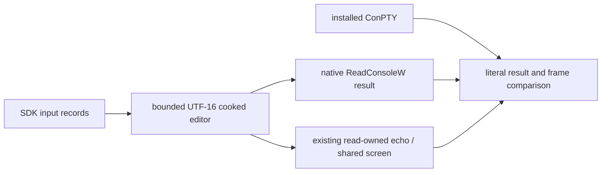
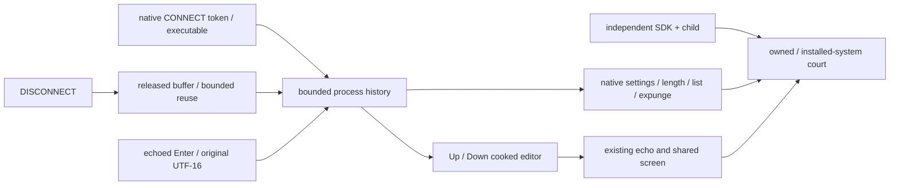
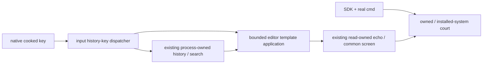
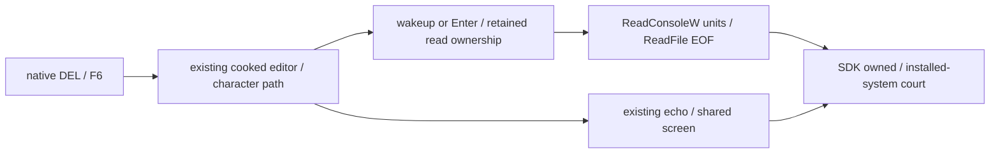
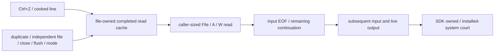

# PRD 02.34 accepted-leaf courts and bootstrap evidence (frozen 2026-10-21)

Extracted verbatim from `prd/PRD_02_34_windows_console_backend.md` on
2026-10-21 so the live PRD stays a product specification rather than a
development history. These are the acceptance charters and court records of
delivered (`[v]`) leaves; the live PRD's Tree remains the status and
invariant index, and current contracts stay in the live PRD. Frozen history:
do not rewrite.

## Verified findings and source identities

### Accepted drawing-attribute leaf

Invariant: native text attributes, subsequent writes and native attribute queries
use the existing VT drawing state, without a second screen model. Evidence must
exercise all 256 foreground/background combinations, reverse/underline, native
access checks and interleaved VT changes through an independent SDK client and
system ConPTY. Unsupported legacy grid/DBCS attribute flags fail explicitly;
rectangular writes, buffer cell readback, palette changes and RGB-to-legacy
quantization remain separate leaves. Dependencies are output request ordering,
the shared parser and native handle access checks. Hot files are the host API
dispatcher/output module and the independent native PTY fixture. Failed output
must propagate before the owned drawing state advances.

### Accepted screen-readback leaf

Invariant: ReadConsoleOutputCharacter A/W and ReadConsoleOutputAttribute are
bounded, non-mutating views of the same VT cells used for output. Evidence uses
independent native SDK buffers, exact counts/bytes/attributes, read-only and
write-only handles, wide-cell clipping, invalid coordinates, row/end boundaries,
UTF-8/OEM conversion and an excessive-transfer rejection. Complex-cell legacy
projection follows the pinned modern source and is distinguished from old
native layouts. Failures zero returned records; no extra screen model is added.
The leaf depends on native file lifetimes, shared cell attributes and ordered
output requests. Hot files are the host dispatcher, output/readback modules,
owned parser's wide-cell creation and native probe. Fill/rectangular writes,
literal C0 cell preservation and multiple screen buffers remain separate work.

### Accepted native-fill leaf

Invariant: FillConsoleOutputCharacter A/W and FillConsoleOutputAttribute edit
the existing shared cells, preserve cursor/drawing state and the untouched
character/style component, and never execute literal cell contents as VT.
Evidence combines SDK fill counts/readback with owned projected cells, access
checks, wide overwrite/padding, controls, OEM conversion and a real cmd clear
regression. Safe failure leaves owned cells unchanged if projection fails;
unsupported legacy attributes/unpaired UTF-16 and excessive projection fail
explicitly with zero native written count. Dependencies are readback, FIFO
output scheduling, native handle rights and shared full/diff projection. Hot
files are the host dispatcher/screen/output modules and the owned parser's
cell/style/edit/serialization modules. Remaining rectangular/multi-buffer and
partial-client-VT interaction work is not replaced by this leaf.

### Accepted mixed-output leaf

Invariant: one authoritative client parser owns UTF-8 and VT grammar. Native
screen operations preserve that input state and reach the consumer at complete
wire boundaries. Immediate controls inside an unfinished sequence execute once;
incomplete bytes cannot capture a later native projection. Evidence must compare
actual SDK readback and consumed PTY cells for fragmented CSI/UTF-8/string
commands, native fill/cursor/attribute calls, cancellation and bounded recovery.
Dependencies are the existing parser, safe native projection and API error
completion. Hot files are the shared lexer/parser, host output/screen/dispatch
and native fixtures. The upstream lexer must expose its own state boundary;
do not reconstruct a parallel VT grammar. Pending bytes have a fixed budget;
overflow rejects the write explicitly, discards only unfinished input and leaves
the host usable. Broader rectangular APIs, signals and default selection remain
separate work rather than substitutes for this stream contract.

Microsoft describes OpenConsole as the open-source console host. Its public
server source contains API dispatch and driver transport; this is a better
starting point than reconstructing those modules from decompiler output.
Public source and the locally installed Windows binary are separate identities:
no exact version or behavioral equivalence has been established.

Reference revision: `microsoft/terminal`
`9fd41b2baec77d25b8cfb584070d5998eab7df81`. Relevant source entry points:

- [README](https://github.com/microsoft/terminal/blob/9fd41b2baec77d25b8cfb584070d5998eab7df81/README.md),
  [license](https://github.com/microsoft/terminal/blob/9fd41b2baec77d25b8cfb584070d5998eab7df81/LICENSE)
  and [organization](https://github.com/microsoft/terminal/blob/9fd41b2baec77d25b8cfb584070d5998eab7df81/doc/ORGANIZATION.md).
- [API dispatch](https://github.com/microsoft/terminal/blob/9fd41b2baec77d25b8cfb584070d5998eab7df81/src/server/ApiDispatchers.cpp)
  and [ConDrv transport](https://github.com/microsoft/terminal/blob/9fd41b2baec77d25b8cfb584070d5998eab7df81/src/server/ConDrvDeviceComm.cpp).
- [ConPTY launch](https://github.com/microsoft/terminal/blob/9fd41b2baec77d25b8cfb584070d5998eab7df81/src/winconpty/winconpty.cpp)
  selects a host executable and carries native handles. Side-by-side launch is
  a feasibility reference, not proof our own host works on every supported OS.

REA official repository: [morluto/rea](https://github.com/morluto/rea).
Latest GitHub release observed on the research date:
[rea-agents-6.7.0](https://github.com/morluto/rea/releases/tag/rea-agents-6.7.0),
published 2026-10-18; tag target
`27dc42d10249f0410904a75c0997842eb03b931c`, package version `6.7.0`.
Its [Windows guide](https://github.com/morluto/rea/blob/27dc42d10249f0410904a75c0997842eb03b931c/docs/windows-ghidra-p0.md)
describes experimental native analysis; its
[CLI evidence contract](https://github.com/morluto/rea/blob/27dc42d10249f0410904a75c0997842eb03b931c/docs/cli.md)
is the operating reference. Native pseudocode and assembly are observations,
not an automatically recovered, buildable C++ project. Use REA for specific
unresolved binary/source differences, with symbols and differential execution.

Ten pinned reference files were downloaded and SHA-256 inventoried locally in
`target/conhost-research/source-inventory.json` (ignored). The observed system
host is file version `10.0.20348.1`, size `987136`, SHA-256
`b925ac56deef971ad6f83aed9eb8328568002c2b033917b70debc7f12e2e3553`.
No REA/Ghidra analysis or reference-host build was executed. REA, Java and
Ghidra were not discovered on the current command search path; that observation
does not establish absence from the machine.

### Initial Windows x86_64 native evidence

`scripts/build.sh test rust_console_ -- --nocapture` executes thirty tests:
sixteen library cases (thirteen native and three state cases) and fourteen
independent native Win32-client cases. The
canonical wrapper visits unrelated workspace/fork suites but filters those
cases out; this is a targeted pass. The original five bootstrap cases remain:

- `rust_console_driver_registers_noninheritable_server_and_reference`: real
  driver registration/reference creation; kernel handle flags checked.
- `rust_console_driver_rejects_a_non_console_handle` and
  `rust_console_driver_rejects_truncated_registration`: kernel rejects the
  invalid handle and incomplete registration, respectively.
- `rust_console_driver_receive_timeout_cancels_and_settles_io`: two real
  asynchronous waits time out and settle; no stale first read blocks the next.
- `rust_console_driver_receives_and_rejects_a_real_cmd_connection`: an
  unchanged cmd fixture receives our private pseudoconsole reference through
  native process attributes. Rust receives CONNECT with the actual child PID,
  completes it as unsupported, and observes non-successful client exit.
  This is not proof cmd commands work. The fixture never invokes the system
  `CreatePseudoConsole`; it is terminated by its owned process handle on failure.

Runtime negatives: making native handles inheritable fails the handle-ownership
assertion; removing the selected reference from process startup fails CONNECT
reception. Both mutations are restored before the positive run. Local logs
remain under ignored `target/conhost-research/`.

An earlier attempt to query `IOCTL_CONDRV_GET_SERVER_PID` returned Win32 error 1
on the observed driver. That attempted identity mechanism is not shipped or
silently treated as supported; the bootstrap proof instead observes a real
kernel-delivered client request on our private server. No kernel-driver rewrite,
Windows aarch64 native pass, complete host implementation or improved stability
is claimed by these initial tests.

Compile-only checks also pass for Windows aarch64 (including test sources) and
the non-Windows Linux x86_64 configuration. The Linux configuration exports no
Windows console service; compilation does not qualify a native runtime.

### Accepted cooked-echo isolation leaf

Invariant: input echo is a native producer, not a continuation of client
VT/UTF-8/UTF-16. Echo must reach the shared screen and consumer immediately
without consuming retained client grammar. Evidence is an actual Win32 caller
with pending CSI/UTF-8/OSC, queued key records, ReadConsoleW text receipts,
native cursor/attribute readback and consumed PTY cells; the installed system
reference is measured separately. Safe failure remains explicit I/O failure;
line limits, read interruption and private-Job authority are preserved.
Dependencies are TerminalStream projections and cooked-read ownership. Hot files
are host input/output and native fixtures. Complete line editing/history,
rectangular APIs and all output-mode combinations are not claimed by this leaf.

Cooked echo now emits complete native projections instead of passing through
client WriteConsole decoding. Each pending read owns its independent shared
`Utf16Decoder`; client WriteConsoleW output owns another. Deleting a retained,
undisplayed high surrogate does not backspace the screen. Read cancellation or
handle closure drops the private echo decoder with that read. Echo does not
alter the client's retained VT/UTF-8, UTF-16 high unit or CR/LF history.
The common decoder API is owned by [terminal library](../PRD_02_35_terminal_library.md).

The actual SDK fixture sets line/echo/processed input mode 7 and output mode 15.
It supplies key records and calls ReadConsoleW while client CSI, UTF-8 and OSC
are unfinished, checking returned UTF-16, native cursor/color and consumed owned
PTY rows. It includes backspace, CJK, a removed unpaired high input unit, and
an emoji surrogate pair. The owned-only extension holds a WriteConsoleW output
high surrogate across an echoed line, then completes the original output pair.
The installed system reference agrees on the three common SDK receipt phases;
its consumed screen differs for the echoed emoji, so wire/cell parity is not
claimed. The fourth streaming-W phase is an owned contract, not an asserted
system equivalence.

Microsoft documents echo into the active screen buffer and the roles of
[console input/output modes](https://learn.microsoft.com/en-us/windows/console/setconsolemode)
and [high-level reads](https://learn.microsoft.com/en-us/windows/console/high-level-console-input-and-output-functions).
The pinned modern `readDataCooked.cpp` independently generates complete display
commands and control notation; the installed reference remains a distinct
binary identity. The new Rust decoder is shared by actual output and echo
consumers; there is no persistent shadow grid or second client VT grammar.

Local logs are `cooked-echo-red.log`, `cooked-echo-positive.log` and
`cooked-echo-extended-positive.log` in the ignored research directory. The first
records an actual owned SDK failure and a passing system receipt reference,
before changing echo routing. Broader output-mode combinations, full cooked
editing/history, control-key display/wakeup combinations, interrupted partial
Unicode reads, encoding/mode changes, broader malformed-scalar/code-page combinations and
large paste/screen clone cost remain explicit qualification work. Default
selection and GUI routing remain unchanged.

Final local evidence: `cooked-echo-final-suite.log` has 178 selected passes,
including 17 repository alignment checks and the new owned/reference native
cases. `cooked-echo-negative-audit.json` records four observed runtime failures
and restored source hashes for client-grammar contamination, stolen output
surrogate state, erasing an undisplayed high input unit, and changed reference
SDK input. Root fmt plus default/experimental workspace all-target strict
Clippy passed. Shared library compile checks cover Linux x86_64/aarch64,
Windows aarch64 and macOS x86_64; the minimal Windows ARM64 PTY consumer and
probe also compile, with existing minimal-feature dead-code warnings. These
are compile-only cross-target receipts. No native ARM/macOS/Linux runtime,
GUI/default selection, full mode matrix or release promotion is claimed.

### Visible replacement-scalar native evidence

The shared parser now preserves U+FFFD in streamed text and native literal
projections; the library contract and callback change are owned by
[terminal state](../PRD_02_24_con_terminal.md). A real SDK client writes it with
WriteConsoleW, UTF-8 WriteFile and FillConsoleOutputCharacterW, then independently
reads native cells/cursor and consumes PTY output. The installed system
reference agrees on these valid-scalar receipts and consumed cells. The owned
extension checks malformed UTF-16 and invalid UTF-8 recovery while preserving
following ASCII and column positions; those malformed cases are not claimed
as installed-system equivalence. Existing native fill projection expectations
now preserve the literal replacement glyph instead of its former dotted circle.

`replacement-scalar-shared-red.log` records a real shared-unit failure before
the print policy changed; `replacement-scalar-native-red.log` records both owned
and system-consumer failures before the change, including the system SDK's
correct native readback. `replacement-scalar-positive.log` covers shared/native
recovery and the existing fill and malformed-surrogate regressions. Logs remain
under the ignored research directory. Final unpaired-unit EOF handling, wider
legacy code pages, arbitrary malformed sequences and GUI/font/runtime matrices
remain separate qualification work.

The final selected suite records 181 passes in `replacement-scalar-final-suite.log`,
including 17 alignment checks and all three new shared/native cases. Three
runtime mutation cases in `replacement-scalar-negative-audit.json` restore
character dropping or the literal placeholder and fail the expected courts;
guard files are byte-restored. Root fmt, default/experimental workspace strict
Clippy and standalone owned-parser strict Clippy passed. Updated shared-library
compile checks cover Linux x86_64/aarch64, Windows aarch64 and macOS x86_64;
the minimal Windows ARM64 PTY/probe consumer also compiles with its existing
minimal-feature warnings. These compile checks do not certify native non-host
runtime, packaging, GUI selection or a default backend change.

### Accepted rectangular screen API leaf

Outcome: native callers can read/write CHAR_INFO rectangles through the owned
PTY service. Invariant: explicit READ/WRITE access, bounded capture and response,
request-row stride preserved under clipping, actual affected rectangle returned,
untouched caller cells preserved by native client unpacking, cursor/drawing
state and pending client grammar preserved. Evidence must use independent SDK
WriteConsoleOutputW/A and ReadConsoleOutputW/A callers, clipped/nonzero origins,
per-cell styles, wide-cell boundaries, real native readback and consumed PTY
cells, with the installed reference measured separately. Safe failure rejects
invalid/oversized/unsupported representations explicitly before mutation;
partial sink failure remains fatal. Dependencies are shared cell edits and
ConDrv completion; no Windows shadow grid or generic platform dependency is
introduced into minicon-console. Multiple buffers, scroll and complete legacy
encoding qualification remain distinct requirements of the overall backend.

The pinned server structs contain SMALL_RECT plus one-byte Unicode, and API
indices 0x02000011 (write) / 0x02000013 (read). KernelBase packs the public source
buffer coordinate/stride before transport; server stride is the requested
rectangle width. Read replies cover the full requested transport buffer so the
native client can unpack only the actual clipped rectangle. Primary public
contracts: [WriteConsoleOutput](https://learn.microsoft.com/en-us/windows/console/writeconsoleoutput)
and [ReadConsoleOutput](https://learn.microsoft.com/en-us/windows/console/readconsoleoutput).

The initial implementation admits scalar single-cell W data, coherent two-cell
wide pairs with matching glyph/style, and A ASCII/single-byte code-page cells.
It validates capture/capacity against one MiB, checked geometry and actual row
stride before editing. Read returns the complete transport-buffer length so
KernelBase can preserve untouched caller cells. Native access is checked before
capture; rectangular calls retain the ordered deferred-output path. Writes edit
a transient shared screen, publish a bounded safe diff and commit only after
sink success. The portable cell operation is owned by
[terminal state](../PRD_02_24_con_terminal.md); no persistent shadow grid is added.

The independent SDK fixture compares clipped negative rectangles with nonzero
source/destination coordinates, sentinel caller cells, per-cell colors,
CP437 A/W conversion, coherent CJK wide pairs, half-wide reads, right/bottom
clipping and explicit READ/WRITE denial. It preserves an unfinished client CSI
through these calls and checks subsequent cursor/color and consumed cells.
`rect-output-red.log` records the real unsupported owned call before dispatch
was implemented, while the installed system's ordinary rectangle case passed.
`rect-output-boundaries-positive.log` records the expanded scoped behavior.

An entirely disjoint read returns invalid-parameter (native error 87), matching
the installed SDK reference and preserving the caller's buffer. A temporary,
byte-restored RPC trace established that a successful zero-area server capture
was mapped by this client DLL to error 1; LastError was explicitly initialized
with a sentinel in the final fixture. Empty writes return a successful empty
rectangle. The installed build 20348 instead leaves the original rectangle on
that successful no-op; the explicit reference branch records this observed
legacy difference. This is not a wire- or version-universal equivalence claim.
The temporary trace lives only in the ignored research directory.

This is scoped support, not completion of all rectangular representations.
Unflagged wide glyphs, orphan/clipped wide writes, non-scalar UTF-16 CHAR_INFO
and legacy grid attributes remain explicitly unsupported. The later indexed-output
leaf extends this initial scope with independent wide-half styles and CP936 DBCS
A rectangles; other multibyte rectangle encodings require separate qualification.
Complex-grapheme readback inherits the existing modern single-unit replacement
policy; native historical variants need separate qualification. Large-screen
clone/diff cost, expanded native version/ISA coverage, real TUI applications,
multiple buffers, scrolling and GUI/default promotion remain open.

#### Real application dependency: read-only font metadata

Windows PowerShell RawUI calls GetCurrentConsoleFontEx before SetBufferContents.
The first actual application run failed there despite passing direct SDK
rectangle tests. The service now handles 0x03000004 (84-byte current-font
message) and 0x03000003 (8-byte font-size message), with output READ access and
known non-emitting dispatch. One private `host/font.rs` encoder owns both views:
font index zero, nominal 8-by-16 cell, scalable monospaced family flags, weight
400 and the terminated `MiniCon Virtual` identity. Unknown indices fail with
invalid-parameter. This is a virtual compatibility descriptor for the headless
cell transport, not an installed face, renderer selection or physical pixel
allocation; actual frontend typography and future negotiated metrics remain
separate work. Font setters and font enumeration remain unsupported.

The SDK fixture checks agreement between both queries and invalid-index failure;
its system reference permits an automatic zero font width instead of assuming
positive physical pixels. The real Windows PowerShell RawUI court constructs
and writes a colored cell array containing Chinese wide text, reads it back,
checks characters/colors and verifies consumed PTY cells. The public
[GetCurrentConsoleFontEx contract](https://learn.microsoft.com/en-us/windows/console/getcurrentconsolefontex)
requires output READ access and remains distinct from frontend rendering.
`rect-output-powershell-rawui-positive.log` and `rect-output-application-positive.log`
record the scoped application runs. Additional applications, Unicode forms and
native version/ISA cells are not inferred from this one client.

Final local qualification is `rect-output-final-suite.log`: 186 selected passes,
including 17 alignment checks, five new tests and the actual Windows PowerShell
RawUI colored/CJK roundtrip. Ten runtime mutation cases in
`rect-output-negative-audit.json` cover row stride, capture budget, sink commit,
row spill, independent reference styles, empty reads, WRITE access, missing
RawUI read/font APIs and inconsistent font views. Every guard is byte-restored.
Root fmt, default/experimental workspace all-target strict Clippy and the
standalone shared-parser strict Clippy passed. Shared-library compile checks
passed for Linux x86_64/aarch64, Windows aarch64 and macOS x86_64; minimal Windows
ARM64 PTY/probe compilation also passed with existing minimal-feature warnings.
These cross checks are compile-only; native non-host cells, all legacy
representations, more real TUI clients and packaged/default qualification remain
open. Exact source, artifact and log hashes stay in the ignored final receipt.

### Accepted region move / native scroll leaf

Invariant: source cells are snapshotted before overlapping moves; destination
copy and exposed-source fill obey explicit screen/clip bounds, preserve cell
text/styles, cursor/drawing state and client grammar, and never push terminal
scrollback as an incidental VT scroll. Shared code owns cell movement and wide
invariants. Windows owns inclusive SMALL_RECT conversion, its 26-byte scroll
message, fill code-page conversion, access and compatibility semantics. Evidence
must include independent ScrollConsoleScreenBufferW/A SDK receipts, overlap in
both directions, clipped/negative/offscreen regions, wide cells, denied access,
safe output failure and real managed-console use. Unsupported representations
fail before commit; capture/projection limits and private-Job authority remain
unchanged. Complete cmd-specific history shims and multiple native buffers are
separate requirements of the overall backend, not inferred from a block move.

The public documentation labels the handle READ, while the pinned dispatcher
requests GENERIC_WRITE; the actual SDK court below resolves this discrepancy
for its recorded system build.
Primary contract: [ScrollConsoleScreenBuffer](https://learn.microsoft.com/en-us/windows/console/scrollconsolescreenbuffer).

The scoped implementation now routes API 0x0200000c through the common
Screen::move_region operation. The 26-byte, pointer-free Windows request keeps
inclusive rectangles, clip/Unicode bytes, destination and CHAR_INFO fill in the
native adapter. Fill accepts one Unicode scalar or ASCII/SBCS code-page cells;
wide fills, lone surrogates and unsupported legacy attributes are rejected.
Native projection shares the same bounded commit-after-output helper as fills
and rectangle writes. This does not feed generated VT into pending client grammar.

The actual SDK reference on the recorded Windows build confirms READ-only
output handles fail with error 5 and WRITE-only handles succeed, matching the
pinned dispatcher's GENERIC_WRITE requirement. The implementation follows that
observed contract, rather than widening access from the documentation label.
The native SDK court checks both overlap directions, clip-limited writes,
negative source translation, offscreen-destination fill, CP437 fill, text/style
readback and retained cursor/attributes/partial CSI. Consumer comparison uses
physical rows: system output may mark full-width seed rows as wrapped, so
Screen::contents concatenation is not a physical-cell equivalence oracle.

The actual Windows PowerShell RawUI ScrollBufferContents client moves a colored
array with Chinese wide cells, validates native readback and checks consumed
PTY cells. Its runtime mutation fails when shared movement is shifted, proving
it exercises this operation. SDK geometry and legacy wide-edge representations
on other Windows versions remain separately unqualified; this one application
is not a complete compatibility claim. The tests are
rust_console_pty_scroll_moves_overlap_clip_and_preserves_client_decoder,
rust_console_client_scroll_matches_system_conpty,
rust_console_client_windows_powershell_rawui_scroll and
rust_console_scroll_validates_fill_and_commits_after_publication, together with
the shared region_moves unit owned by PRD 02.24. Five observed runtime mutation
cases in ignored scroll-output-negative-audit.json cover translation, the shared
unit, sink commit order, independent SDK style expectations and WRITE access.
Every source guard was byte-restored before final qualification.

Final local region-move qualification: scroll-output-final-suite.log records
191 selected passes including 17 alignment checks and five added tests. The
restored guards in scroll-output-negative-audit.json were rechecked after strict
lint fixes. Root fmt, default and experimental workspace all-target strict
Clippy, and standalone shared-parser strict Clippy passed. Updated library
compile checks passed for Linux x86_64/aarch64, Windows aarch64 and macOS x86_64.
The minimal Windows ARM64 PTY/probe check passed with existing minimal-feature
warnings. These are compile-only cross-target receipts; native non-host runtime,
full legacy scroll behavior, packaging and default selection remain open.
Exact source/log identities are in ignored scroll-output-final-receipt.json.

### Accepted indexed-output leaf

Invariant: WriteConsoleOutputCharacter A/W and WriteConsoleOutputAttribute use
bounded coordinate-based edits of the existing common screen. Text preserves
per-cell attributes; attributes preserve text/width. Cursor, drawing state,
client grammar and history are unchanged. Shared code owns literal span layout
and wide-row padding; the native adapter owns its 12-byte request, code pages,
UTF-16/byte record counts, legacy flags, WRITE access and zero counts on failure.

Evidence must combine independent SDK/system observations for cross-row spans,
CJK, literal controls, OEM/UTF-8 text, end clipping, invalid origins, distinct
attributes and restricted handles; shared tests must exercise retained grammar,
wide healing and state, and native tests must prove sink-before-commit and
bounded rejection. Actual managed-console regression remains part of the
application frontier, with its exact APIs distinguished from SDK coverage.
Safe failure rejects unrepresentable malformed UTF-16/legacy attributes before
publication, never pretends a complete legacy UTF-16 cell model. Dependencies
are existing readback/rectangle views, output ordering and shared literal edits.
Hot files are host dispatch/screen edits and independent native fixtures.
Multiple screen buffers, font rendering and default promotion remain separate
parts of the overall backend rather than implied by this leaf.
Primary contracts: [text](https://learn.microsoft.com/en-us/windows/console/writeconsoleoutputcharacter)
and [attributes](https://learn.microsoft.com/en-us/windows/console/writeconsoleoutputattribute).

The real managed move initially failed in ReadConsoleOutputA, not in the new
indexed API: Windows PowerShell 5's framework selected ANSI rectangle calls.
The accepted dependency extension is CP936 DBCS rectangle read/write: preserve
lead/trail byte positions, both per-cell styles and scalar identity, reject
orphan/incomplete/malformed pairs before commit, and prove SDK roundtrip plus
actual Console.MoveBufferArea. General UTF-8 rectangle packing and every legacy
DBCS boundary policy remain open; record any evidence-limited semantics.

Indexed output now uses common write_cell_text/write_cell_styles and the existing
bounded native commit helper. API 0x02000012 has COORD, StringType and NumRecords;
input capture starts after its 12-byte body and 8-byte driver header. Records
are cleared before access/capture errors. W returns consumed UTF-16 units;
A converts through the current output CP and counts the converted prefix bytes.
The one-MiB input/projection limits remain explicit. Unlike client streaming,
malformed UTF-16 input fails before any screen commit. Supplementary scalars are
retained by the common model, with native count/clipping unit coverage; old
raw-surrogate cell layouts remain a separate representation frontier.

The SDK fixture checks all physical CHAR_INFO cells, independent per-cell
attributes, cross-row CJK/padding, literal controls/combining/replacement,
CP437 and UTF-8 byte counts including clipped UTF-8, zero/invalid origins and
READ-only/WRITE-only handles. The installed build 20348 returns error 87 for
nonempty invalid origins, while the pinned modern FillConsoleImpl returns zero
success there. Empty input remains success/zero. These observed version scopes
are separate, rather than a claim of universal dispatcher parity.

CP936 rectangle A support decodes coherent lead/trail bytes to one wide scalar,
preserves distinct attributes in both cells, and rejects malformed/orphan pairs
before publication. Readback returns the corresponding encoded byte per cell.
The same pair validation now admits distinct W half-cell styles. The observed
system 20348 ANSI roundtrip uses FFFF for the W trailing-cell character; our
existing modern readback derives that character from the lead cell. The native
byte pair, attributes and displayed scalar agree, while this raw legacy W layout
remains a recorded difference. The SDK oracle branches explicitly for that build;
owned readback must retain its canonical lead-derived representation.

The real Windows PowerShell 5 managed Console.MoveBufferArea court uses explicit
CP936 and moves a colored CJK array through ANSI rectangle/fill calls, reads it
back and checks consumed PTY cells. Its initial failure and byte-restored RPC
observation are recorded in indexed-output-managed-rpc.log; it is application
coverage for those actual calls. Indexed-string coverage is supplied by the
independent SDK court. Malformed pair/style and failed-sink units remain separate
from the application trace. More code pages, half-wide native boundaries, native
OS/ISA cells and full legacy representation compatibility remain open.

Wide-half style preservation here is a native cell-metadata contract. A VT wide
glyph is drawn from its lead style; independent tail-only visual formatting is
not qualified as a separate glyph operation. The SDK/native readback oracle and
the consumed terminal-cell oracle retain their distinct scopes.

Final local indexed/DBCS qualification: indexed-output-final-suite.log records
197 selected passes, including 17 alignment checks and six new tests. Ten runtime
mutation cases in indexed-output-negative-audit.json prove shared text/styles,
UTF-16 record counts, input budget, sink commit, pair validation, DBCS byte order,
independent reference styles, WRITE access and capture offset. All guards were
byte-restored, including the mutation that fails both the SDK and real managed
application. Root fmt, default/experimental workspace all-target strict Clippy
and standalone shared-parser strict Clippy passed. Updated library compile
checks passed for Linux x86_64/aarch64, Windows aarch64 and macOS x86_64. Minimal
Windows ARM64 PTY/probe compilation passed with existing minimal-feature warnings.
These cross checks are compile-only; non-host native runtime, wider code-page/
legacy-cell coverage, multiple buffers, packaging and default qualification stay
open. Exact source, log hashes and remaining scope are recorded in ignored
indexed-output-final-receipt.json.

### Accepted cursor-info and cursor-replay leaf

Invariant: SetConsoleCursorInfo validates its 1..100 native size and output
handle, changes visibility through the common terminal stream and commits
native metadata after sink success. Native size is adapter metadata; shared
shape/blink/visibility remain OS/ISA-neutral. Native changes preserve cursor
position, cells, drawing attributes and unfinished client grammar. Public full,
diff and cursor-state replay must reproduce all common cursor appearance.

Evidence must include an independent SDK/system court for all valid sizes,
invalid sizes and output/input/restricted handles, same-size visibility changes,
interleaved DECSCUSR, partial CSI, native readback and consumed state. Real
Windows PowerShell 5/7 properties must exercise the native service. Safe failure
preserves native metadata and common state on invalid input or pre-write sink
failure; publication is still fatal after partial transport failure. Dependencies
are shared cursor parser/damage, the stream facade and ordered native output.
Hot files are native host dispatch/cursor module, common screen replay and SDK
fixtures. Pixel-exact percentage rendering, multiple buffers and promotion are
separate requirements of the overall backend, not implied by a VT projection.

The pinned getset.cpp validates size and emits DECTCEM in its VT writer path;
screenInfo.cpp retains a legacy size and preserves an explicit cursor type on
same-size visibility changes. Dispatcher access is WRITE although the public
page says READ; the actual SDK court below establishes this on the current system.
Primary references: [API contract](https://learn.microsoft.com/en-us/windows/console/setconsolecursorinfo),
[pinned routines](https://github.com/microsoft/terminal/blob/9fd41b2baec77d25b8cfb584070d5998eab7df81/src/host/getset.cpp)
and [buffer state](https://github.com/microsoft/terminal/blob/9fd41b2baec77d25b8cfb584070d5998eab7df81/src/host/screenInfo.cpp).

The native implementation now serves API 0x02000006 with an eight-byte body
(size ULONG, visibility BOOLEAN and padding). Default native size remains 25;
GetConsoleCursorInfo reads the retained value instead of a fixed reply and
reads visibility from the common screen. Range checks precede publication;
metadata changes only after DECTCEM publication succeeds. The setter remains an
ordered emitting request, while the existing non-emitting getter can bypass
output backpressure. Shared shape/blinking are preserved across native changes,
including a changed percentage, matching the pinned VT writer's projection.
Pixel-exact native legacy geometry and additional buffer state remain open.

The independent SDK uses every size 1..100 with false/noncanonical-true input,
checks exact normalized readback, invalid ranges and unchanged state, output
READ-only/WRITE-only handles and an input handle. Actual current-system access
is WRITE; READ-only fails with error 5, input handles with error 6 and invalid
sizes with error 87. Interleaved VT styles, same-size updates and partial CSI
are checked at eight handshake stages. System cursor rendering is asynchronous:
the consumer waits for observed appearance and complete ordinary fences, not
only the API return/title marker. At the deliberately unfinished client-CSI
stage, wire grammar and hidden cursor position can still be pending; native
position/attributes must remain exact, and resumed text must appear with the
expected position/color. The following completed stages establish restoration.
This distinction is recorded by cursor-info-fenced-reference.log and the final
positive court, rather than turning an observation timeout into a passing state.

Windows PowerShell 5 and PowerShell 7 property clients exercise Console.CursorSize,
Console.CursorVisible and RawUI.CursorSize, retain explicit VT bar/steady style
through same-size native updates, and validate query results and consumed output.
Native/core and common replay units exercise pre-write failure, bounds and all
three replay paths. cursor-info-red.log records a real unsupported owned API;
cursor-replay-red.log records the separate shared replay runtime failure.

Final local cursor qualification: cursor-info-final-suite.log records 203 selected
passes, including 17 alignment checks and six added tests. Ten runtime mutation
cases in cursor-info-negative-audit.json prove each shared replay path, native
query values (failing SDK and both real PowerShell clients), metadata commit,
visibility, retained grammar, range checks, WRITE access and the independent
reference query oracle. Every guard was byte-restored before final qualification.
Root fmt, default/experimental workspace all-target strict Clippy and standalone
shared-parser strict Clippy passed. Library compile checks passed for Linux
x86_64/aarch64, Windows aarch64 and macOS x86_64; the minimal Windows ARM64 PTY/
probe check passed with existing minimal-feature warnings. These are compile-only
cross-target receipts. Native non-host runtime, pixel-exact percentage rendering,
multiple buffers, packaging and default qualification remain open. Four pinned
source blobs were verified against their Git tree identities; ignored
cursor-info-final-receipt.json records source/log/image hashes and evidence scope.

### Accepted native-geometry leaf

Invariant: native screen-buffer dimensions, window rectangle and parent-owned
PTY dimensions have explicit owners. A native setter must not silently equate
these merely because the initial values match. Coordinate bounds, cursor/data
preservation, relative rectangle arithmetic, resize events and bounded failure
must be validated against actual SDK/system behavior. Shared geometry/projection
mechanisms remain OS/ISA-neutral; Win32 body layouts, rights and error mapping
stay native. Native API mutations must preserve client grammar and input/Job
lifecycle; failed publication cannot silently advance observable state.

Evidence begins with independent GetLargestConsoleWindowSize,
SetConsoleScreenBufferSize and SetConsoleWindowInfo calls, sizes/readback before
and after growth/shrink/relative moves, invalid arguments and restricted handles.
Actual managed size properties and parent PTY resize must be tested separately.
Source comments/headless paths differ from the public desktop documentation;
measure these before choosing the projection model. Dependencies are current
common terminal state, bounded publication and native resize/input ordering.
Hot files are native host/geometry, shared screen/view contracts and SDK probes.
Safe failure uses explicit status/budget errors without pretending an ignored
request succeeded. Pixel monitor metrics and a desktop window are not implied
by a headless terminal; full buffer/view semantics remain required by the
backend and are not reduced to a size-query-only success condition.
Primary contracts: [buffer size](https://learn.microsoft.com/en-us/windows/console/setconsolescreenbuffersize),
[window rectangle](https://learn.microsoft.com/en-us/windows/console/setconsolewindowinfo)
and [largest window](https://learn.microsoft.com/en-us/windows/console/getlargestconsolewindowsize).

The scoped implementation now serves native buffer-size (0x02000009, COORD),
window-info (0x0200000e, BOOLEAN/padding/SMALL_RECT, ten bytes) and largest-window
(0x0200000b, COORD) requests. All require WRITE. The new largest query is known
non-emitting; setters remain ordered. A headless virtual display advertises a
32766 coordinate ceiling per axis, independently of its one-Mi-cell allocation
budget. These are virtual native limits, not font/monitor metrics. Parent and
native size validation share this ceiling. GetScreenBufferInfo reports the
actual drawing buffer, viewport rectangle and buffer-limited native maximum.
The installed system's monitor-derived largest value is recorded independently.

Native buffer growth retains the window dimensions. Headless window-size changes
resize the drawing buffer and normalize the requested viewport into valid bounds
using inclusive extents; no desktop window is created or remote physical resize
silently requested. This differs from the observed build 20348's out-of-range
relative/offset rectangles, which remain explicit reference-only legacy layouts.
Reversed rectangles fail; one-cell windows work, as the actual SDK demonstrates.
Parent PTY resize updates the display/drawing dimensions and publishes a complete
viewport. Resize-event capacity is checked before publication and events follow
the state commit. Build 20348's parent resize can first report an intermediate
24x16 event while its subsequent query is 24x12; the reference records that
observation. The owned event reports committed 24x12. Applications should still
query authoritative geometry after receiving native resize notifications.

After geometry separates buffer and display, the Windows host consumes common
TerminalViewport mapping for client output and native edits. Thus a 32-column
buffer retains all 40 written characters while the 16-column peer receives
0123456789abcdef on row zero and wxyzABCD on row one, in both VT and processed
legacy output. Native readback retains offscreen data. Native cursor commands
follow both cursor axes. Ordinary output follows rows while preserving the
horizontal interval, matching the independently observed expanded-buffer writes
and long-output cases. Original partial VT/UTF-8 grammar,
nonvisual frames and alternate-grid transitions survive. Existing cell/style/
rectangle/scroll edits use this same viewport publication path, not a second
Windows screen. ASCII/CR-LF runs publish in batches in VT and legacy modes;
the core unit guards against per-glyph whole-screen publication.

Independent SDK cases cover buffer/window growth, relative/offset behavior,
invalid sizes/rectangles, restricted handles, expanded-buffer drawing in both
output modes and parent resize events/final queries. Real Windows PowerShell 5/7
clients exercise Console buffer/window properties and offscreen colored CJK
RawUI read/write, then validate consumed output. Shared/native units cover wide
edge healing, pending grammar, events, output/queue budgets and sink-before-commit.
Full wrapped-line reflow policy, all scrolling/origin interactions, non-ASCII/
control-heavy large-buffer performance, more native versions/ISAs and promotion
remain open. Current resizing preserves/clips the common drawing rows; it does
not claim the system's registry-dependent reflow policy. Exact system geometry
oracles are qualified for the recorded 20348 build; other builds require their
own runtime evidence instead of an implicit pass.

Local geometry qualification: `geometry-final-suite.log` records 214 selected
serial passes, including 17 alignment checks. `geometry-final-new-tests.log`
separately records all eleven added tests. Twelve runtime guard mutations in
`geometry-negative-audit.json` fail every added test: wide-pair repair, exact
fork grammar, effect forwarding, sink-before-commit, native buffer dispatch
(SDK and both real PowerShell clients), WRITE access, actual host projection,
parent viewport dimensions, ASCII batching and three independent system-reference
oracles. Sources were byte-restored before the final runs.

Root fmt, default/experimental workspace all-target strict Clippy and standalone
shared-parser strict Clippy passed. Library checks passed for Linux x86_64 and
aarch64, Windows aarch64 and macOS x86_64. The minimal Windows ARM64 PTY/probe
all-target check passed with existing minimal-feature warnings. Cross-target
checks remain compile-only; runtime evidence is Windows x86_64 build 20348.
`geometry-final-receipt.json` records the source tree, restored guard hashes,
logs, actual executable identities, compiler and qualification scope.

The initial parallel selected run had one eight-second wait timeout in the
existing Windows PowerShell RawUI rectangle client. Its isolated repeat and the
complete serial run passed without product changes. The failure is retained in
`geometry-parallel-suite-failure.log` and the isolated result in
`geometry-rawui-isolated.log`; the cause and parallel reliability remain open.

### Accepted multiple-buffer leaf

Invariant: an output file object binds to one native screen buffer; activation
changes the displayed buffer, not existing handle bindings. Each buffer owns
common terminal state/grammar and native per-buffer modes/cursor/viewport;
console code pages, input, process/Job authority and physical output ownership
remain console-wide. Inactive writes/readback must remain independent and must
not draw into the active peer. Activation publishes a complete current image
before changing the active identity. Failed publication retains the old active
state. Object closure/disconnect must reclaim unused buffers without invalidating
live duplicates or an unrelated buffer. Counts and total cells are bounded.

Evidence: independent CreateConsoleScreenBuffer/SetConsoleActiveScreenBuffer SDK
calls, buffer/window inheritance, modes/styles/cursors/readback, inactive writes,
CONOUT reopen and duplicate/final-close behavior, fenced consumer snapshots and
real managed buffer clients. Measure the installed system before choosing
version-specific fallback or parser-fragment expectations. Shared snapshots and
streaming remain in the common library; Win32 identity/access/closure policy is
native. Dependencies: handle lifetimes, common viewport publication and output
ordering. Safe failure is explicit access/argument/resource status or fatal
transport I/O; no success-only activation. Non-goals: a new input/Job owner,
desktop windows or default promotion before full backend qualification.

Primary contracts: [create buffer](https://learn.microsoft.com/en-us/windows/console/createconsolescreenbuffer)
and [activate buffer](https://learn.microsoft.com/en-us/windows/console/setconsoleactivescreenbuffer).

The scoped implementation serves NEW_OUTPUT creation from the driver's twelve-
byte create record plus twelve-byte text-buffer payload, and activation API
0x02000002 (no body, WRITE required). Every output handle binds to a stable
native buffer identity. Current-output opens and new connection defaults bind
to the currently active identity; duplicated native handles retain the original
file object until the driver's final close. Share checks apply to the selected
buffer, not every output buffer in the console.

The active drawing state remains in ConsoleHost; inactive buffers retain their
own TerminalStream, viewport, output mode, cursor percentage, UTF-16 decoder and
CR/LF state. A scoped context swap routes inactive requests through the same
native API implementation and common terminal mechanisms with a discarded wire
sink, restoring the active context on both success and I/O failure. Input, code
pages, title metadata, private-Job/process authority and output scheduling stay
console-wide. New buffers start blank at the active window's size and inherit
drawing attributes; the measured headless default mode is 7 and cursor is 25,
visible. They do not inherit screen contents, cursor position or client grammar.

Activation publishes a normalized full shared Screen viewport snapshot before
committing the identity and state swap. Common write_viewport_activation also
selects the target stream's logical alternate layer; native code owns only the
buffer identity/commit and status translation. Physical size stays parent-owned. Native
cursor/geometry operations and common state remain bound to each logical buffer;
no Windows shadow grid is introduced. Unused inactive buffers are reclaimed;
closing the active buffer selects the newest remaining live buffer, matching
the pinned source list order and the scoped installed-system SDK case. With no
live replacement the last image is retained until session teardown.

There are at most sixteen native buffers and one Mi drawing cells across their
logical grids, including the temporarily parked active context during an
inactive resize. Creation and resize check the aggregate before allocation.
Output ordering includes finalizers which may switch the active image. Their
queue reserves bounded capacity for the maximum retained handles/connections,
even when the ordinary 64-request output queue is full. Disconnect cancellation
preserves queued file finalizers. Character/rectangle readbacks (0x0200000f and
0x02000013) join the known non-emitting query list and remain live under pressure.

The independent SDK court fences six consumed images and checks new-buffer
geometry/attributes, inactive writes, per-buffer cursor/mode values, current-
output reopen, duplicates, final-close fallback and twenty-four create/close
cycles. A pressure court fills the actual output queue, issues an active final
close, reopens/reads the still-displayed buffer and then drains output to observe
the fallback. CloseHandle return is not treated as proof of completed server
reclamation: the kernel finalizer can be asynchronous. The initial pressure
fixture exposed blocked readback while the non-emitting mode/info queries were
already live; buffers-pressure-progress.log retains that runtime failure.

Real Windows PowerShell 5/7 clients combine native buffer creation/activation
with managed Console properties/writes and RawUI readback through the original
inactive handle, fence a CJK alternate image and restore the modified original
image. The native unit covers failed activation, context restoration on error,
independent CSI/UTF-16 fragments, aggregate allocation/count bounds and collection.
Full native-buffer/VT-alternate interactions, further process-exit/attach/
inheritance orders and access variants, additional system versions/ISAs,
large-buffer performance and default promotion remain open qualification work.

The nine-stage native/VT handoff case below qualifies independent saved pairs and
incomplete CSI across switches; expanded-alt sizing, resize/margin interactions,
other alternate selectors and additional close/exit orders remain open.

#### Accepted buffer process-family lifetime leaf

Invariant: creator exit does not retire a live inherited output file object;
last-holder exit restores another live buffer without changing its native state
or replaying the retired buffer's unfinished grammar. Repeated process-family
rounds must reclaim buffers rather than exhaust the native count limit. Evidence
must combine actual SDK calls, retained child-process handles, exact console
client lists, native readback and fenced downstream snapshots through the PTY
facade, with a distinct system ConPTY reference. Safe failure uses bounded waits
and the fixture's private-Job shutdown; no foreign-process lookup or termination.
Dependencies: ConDrv finalizers, connection lifetime and common screen projection.
Non-goals: all inherited object/access variants, all implicit-exit orders,
VT-alternate interaction or non-host ISA runtime qualification.

The family court also requires GetConsoleProcessList as an observable native
connection-lifetime boundary. The accepted adapter serves API 0x03000029 with
the four-byte process-count body and DWORD output array from the pinned layer-3
definition. Return the complete distinct live PID set from this console's
connection registry, never system process enumeration. An undersized buffer gets
the required count and no partial array; allocation is bounded by MAX_CLIENTS,
not by caller capacity. The query must remain non-emitting under backpressure.
Evidence must cover sufficient/short buffers, SDK null/zero rejection, exact
retained-child PID membership and output-pressure progress. Source and contract:
[GetConsoleProcessList](https://learn.microsoft.com/en-us/windows/console/getconsoleprocesslist),
ApiSorter.cpp, ApiDispatchersInternal.cpp and dep/Console/conmsgl3.h at tree
9fd41b2baec77d25b8cfb584070d5998eab7df81. No public portable process/session API
is inferred from this Windows capability.

The actual family fixture keeps its original buffer alive, starts a creator
that activates another buffer, passes a reopened output file to a separate
child, then exits the creator through process teardown without Rust File drops.
The surviving child's inherited handle is queried and written after creator
exit. Retained process handles and exact native PID sets establish the two-client
and one-client boundaries; no PID lookup is used to select or terminate a target.
After the last holder exits, a reopened CONOUT observes the original buffer and
a fenced peer snapshot must restore its cells, colors, cursor and visibility.
Native mode/attribute/cursor-percentage queries are checked against the current
stage's report. Painted cell colors are compared; the renderer's incidental
final SGR state is not a native buffer attribute oracle. Each fixture completes
18 rounds, exceeding the sixteen-buffer limit, and drains actual output EOF.

The owned court runs both complete-input and unfinished-UTF-8 retirement modes
(36 rounds). Its peer transcript must remain valid UTF-8: retired buffer grammar
cannot be flushed into the replacement buffer. A distinct system ConPTY court
runs the same complete-input family (18 rounds). The earlier system-tail attempt
in `buffer-family-initial.log` instead observed BASE followed by U+FFFD after
fallback/title fencing on build 20348. That is a separate compatibility finding,
not a passing malformed-tail equivalence claim or a proven root cause. Broader
native/VT grammar and process-exit combinations remain open.

`buffer-family-process-list-red.log` and the native error receipt record error
50 before GetConsoleProcessList was implemented. The final adapter returns the
registry's real PIDs rather than server tokens, reports required short capacity
without a partial list, and passes SDK null/zero argument checks. The existing
output-pressure fixture now requires this API to finish before consumption
resumes; removing its non-emitting bypass produces an observed runtime failure.

Local qualification: `buffer-family-final-suite.log` records 233 selected passes
including 17 alignment checks; `buffer-family-final-focused.log` separately records
both new tests and the extended pressure test, with all 54 family-round receipts.
Eight byte-restored guard mutations fail at runtime, covering missing API,
wrong PID membership, short-count semantics, query bypass, close fallback,
buffer reclamation, retired grammar leakage and the system-reference oracle.
Ten static/build checks pass: default/enabled workspace strict all-targets Clippy,
both standalone parsers' strict Clippy, lexer no-std build, four common-library
cross-target builds and the Windows ARM64 platform PTY/Rust-console all-targets
build. Non-host targets are compile-only; actual runtime is Windows x86_64 build
20348. Three source blobs match the pinned tree. `buffer-family-final-receipt.json`
binds source, guard/check/log hashes, compiler, executable identities and remaining
scope. Final documentation edits are followed by alignment checks.

Local multiple-buffer qualification: `buffers-final-suite.log` records 220
selected serial passes, including 17 alignment checks; the six added tests also
pass independently in `buffers-final-new-tests.log`. Sixteen runtime guard
mutations in `buffers-negative-audit.json` establish activation commit ordering,
context restoration, independent UTF-16 decoding, aggregate/parked allocation
bounds, buffer count and collection, creation dispatch (SDK and both actual
PowerShell clients), reopen identity, share domains, suppressed inactive output,
activation access, finalizer ordering, both pressure-time readbacks and the
independent system-reference oracle. Every recorded guard matches restored
source bytes. The corrected pressure court observes the wrong active buffer
when close ordering is removed, and blocks when either readback is gated.

The source dispatcher identifies 0x02000013 as rectangle read and 0x02000011 as
rectangle write; only the read operation bypasses terminal output scheduling.
Both character and rectangle readbacks execute before the parent begins draining
the actual output queue. The prototype close-return/readback observations are
not substitutes for the final fenced court and source-matched mutation receipts.

Root fmt, default/experimental workspace all-target strict Clippy and standalone
shared-parser strict Clippy passed. Library checks passed for Linux x86_64 and
aarch64, Windows aarch64 and macOS x86_64; the minimal Windows ARM64 PTY/probe
all-target check passed with existing minimal-feature warnings. These cross-
target results are compile-only; native execution remains Windows x86_64 build
20348. Eight reviewed source blobs match their pinned Git-tree identities.
Ignored `buffers-final-receipt.json` records the tree, compiler, actual executable
identities, log/guard hashes and remaining qualification scope.

### Accepted Unicode-publication leaf

Invariant: ordinary Unicode text must not clone the whole logical screen once
per scalar after viewport mode is entered. Bound encoded runs and publication
work; use the authoritative VTE lexer for read-only text lookahead, and one
shared scalar-width policy for native margin translation. Unicode, fragments,
callbacks, errors, native CR/LF/immediate wrap and VT delayed wrap must preserve
their existing semantics. Generic text/frame mechanisms stay OS/ISA-neutral;
Windows mode/code-page translation remains native.

Evidence: counted shared/native publication calls, batched versus single-scalar
model and projected-cell equivalence, fragmented grammar and effect fences,
independent W/UTF-8 SDK bulk writes and system reference, actual managed clients,
and observed runtime guard failures. Safe failure retains staged commit after
sink acceptance and the existing pending/projection bounds. Dependencies are
common framing, viewport projection and native text modes. Non-goals: claiming
all control-heavy/large-grid performance or other-ISA runtime from one host.
Malformed UTF-8 recovery is qualified independently of valid-text batching;
the accepted prefix-invalidation leaf below owns its interleaving/final-tail
evidence and the intentional canonical encoding of rejected prefixes.

The native UTF-16 producer now collects bounded UTF-8 runs for all sessions,
including unmapped output. Native UTF-8 writes resume shared text lookahead after
each completed fragment/control instead of remaining byte-at-a-time for the rest
of the request. Mode-specific translation counts the shared scalar widths,
handles wide-margin/no-wrap placement and immediate legacy versus delayed VT
wrapping, then publishes a complete run. Processed CR/LF policy remains native;
effectful controls use the existing path. Legacy fallback wrapping now waits for
a complete input boundary, so changing from VT to legacy while UTF-8 is partial
cannot inject a newline into the unfinished scalar.

The counted pre-change cases record 3,584 shared publications for 512 Unicode
groups (`unicode-batch-framer-red.log`) and 1,280 native mapped updates for the
256-group mode-zero case (`unicode-batch-native-red.log`). The shared case now
publishes once; native ordinary runs are bounded independently of input size.
The native unit compares batched and single-scalar screen state across modes
0/2/3/7/11/15, narrow/wide margins, newline/control sequences and VT-to-legacy
fragment transitions. Public-facade evidence fences BEL, Unicode C1 and title
effects between text, retains UTF-8 across a native command, and rejects failed
or over-budget publication without committing the candidate screen/view.

The independent SDK writes 8,192 UTF-16 units or 13,312 UTF-8 bytes into a
256x64 logical buffer with a 128x32 peer, in modes 3/7/11/15. Owned receipts
validate written counts, canonical scalar cursor positions and every projected
row; the observed wire is 6,790 bytes and the court bounds amplification. Actual
Windows PowerShell 5/7 clients exercise managed bulk output and geometry/cursor
properties with the same decomposed/CJK/supplementary data.

System layout is a separate observation, not a passing equivalence claim. The
installed Windows 20348 host returns cursor (6,36), stores the combining mark in
its own UTF-16 cell and reports two replacement-character cells for this emoji
in the rectangle read, even with VT processing enabled. Its consumed transcript
also differs. `unicode-batch-reference-layout.log` preserves the initial failed
canonical-layout comparison; `unicode-batch-system-observations.log` records all
eight W/UTF-8/mode cases. The reference court pins this build and these native
values and requires actual bulk output; other builds remain unqualified.
The owned backend retains the pre-existing coherent Unicode scalar model.
Raw UTF-16/legacy-layout compatibility and remaining VT-origin/scroll-region/
manual-scrollback follow semantics remain open; these findings do not certify that the installed host and
owned backend produce interchangeable legacy API layouts.

Local Unicode-publication qualification: `unicode-batch-final-suite.log`
records 227 selected passes, including 17 alignment checks;
`unicode-batch-final-new-tests.log` separately records all seven new tests.
Sixteen byte-restored guard mutations produced runtime failures covering every
new test. Eight checks passed: default/enabled workspace strict all-targets
Clippy, standalone parser strict Clippy, four common-library cross-target builds
and the Windows ARM64 platform PTY/Rust-console all-targets build. Cross-target
results are compilation evidence only; actual native execution remains Windows
x86_64 build 20348. Ten reviewed upstream source blobs match the pinned Git-tree
identities. `unicode-batch-final-receipt.json` binds source tree, guard/check/log
hashes, compiler, four executable identities and remaining qualification scope.

An earlier serial suite timed out at the installed system ConPTY cursor fence
(`rust=false`, `bar-hide`); its isolated recheck and the subsequent full serial
suite passed without code or timeout changes. This reference-host timing finding
does not establish a backend regression or resolve the reference's reliability.

### Accepted invalid UTF-8 prefix-invalidation leaf

This leaf's parser recovery contract is independent of the viewport movement
policy qualified in the vertical-follow leaf below.

Invariant: a rejected unfinished prefix publishes one replacement before a new
UTF-8 scalar, VT frame, effect or native edit. Only the new unfinished grammar
is retained for final output. The shared lexer reports prefix invalidation using
the same UTF-8 validator as its decoder; the shared framer stages recovery with
fresh input grammar and restores the original lexer on sink rejection. Native
code consumes the existing TerminalStream paths without another decoder.

Evidence: public common-facade raw/viewport tests compare incremental state,
effects, cursor/style, native interleaving and final tails; raw recovery rejection
is retried with a different byte that must complete the original scalar. Actual
WriteFile/ReadConsoleOutputCharacterW/SetConsoleCursorPosition clients exercise
both raw and expanded-buffer sessions, observing the first replacement before
allowing continuation and then exiting with a new unfinished prefix. Safe
failure retains original pending bytes, screen and grammar before publication;
projection limits and accepted earlier frames retain their existing contracts.
Dependency: shared grammar/transactional publication. Non-goals: malformed raw
byte identity, system-host malformed decoding parity, all legacy margin policy,
or non-host ISA runtime certification.

The initial public-facade reproduction (`utf8-recovery-red.log`) accepted
E4 B8 E3: authoritative state had U+FFFD, while the projected peer was empty.
The old retained prefix could also be replayed by finalization after the source
had already applied its replacement. Recovery now canonically publishes U+FFFD
for E4 B8 before retaining E3, leaving the peer at ground for native edits.
Completing E3 81 82 after native cursor movement writes the same U+3042 to native
readback and peer cells. Finalization forwards only the new unfinished prefix.
The common mechanism and valid-frame byte-preservation boundary belong to
[PRD 02.24](../PRD_02_24_con_terminal.md#invalid-utf-8-prefix-recovery).

Local receipts: `utf8-recovery-final-suite.log` records 231 selected passes,
including 17 alignment checks; `utf8-recovery-final-focused.log` records all four
new tests separately. Seven byte-restored guard mutations produce runtime
failures covering every new test. Ten checks passed: default/enabled workspace
strict all-targets Clippy, both standalone parsers' strict all-targets Clippy,
the lexer no-std library build, four common-library cross-target builds and the
Windows ARM64 platform PTY/Rust-console all-targets build. The standalone lexer
MSRV lint caught a too-new helper; the final implementation preserves its
existing Rust-version declaration. Cross-target results are compilation only;
native SDK execution is Windows x86_64. `utf8-recovery-final-receipt.json` binds
the source tree, guard/check/log hashes, compiler, executable identities and
remaining scope. Final documentation edits are followed by alignment checks.

### Accepted native-buffer / VT-layer handoff leaf

Invariant: each native buffer retains its own logical main/alternate grids and
unfinished client grammar. Activating a buffer publishes its image and logical
VT layer before committing native identity. Inactive writes cannot change the
displayed stream. Leaving logical alternate mode repaints that stream's saved
main image, independent of whichever main grid the peer previously displayed.
Shared activation/projection and error types belong to PRD 02.24; Win32 identity,
native status mapping and kernel-finalizer authority remain native. Safe failure
preserves identity before sink acceptance; partial sink I/O retires the transport.
Dependencies are independent TerminalStreams, viewport snapshots and ordered
kernel requests. Non-goals: every alt selector/geometry/scrollback interaction,
all close/exit orders, or byte-for-byte system renderer equivalence.

`buffer-vt-red.log` records the owned layer changing to main at stage 3 while its
logical alternate contents were still active. Native activation now delegates
to common write_viewport_activation, which selects the logical layer and renders
the full transient image without consuming cells, callbacks or client grammar.
Generated projections use portable ProjectionLimit quota errors instead of
originating Windows error 1450 in the common module. Geometry, native edits,
activation and ordinary-output adapters translate that typed failure into their
existing native statuses; unrelated sink failures remain distinguishable.

The independent SDK fixture creates a second native buffer while the original
is in VT alternate mode, writes an inactive CARRY plus partial CSI, enters the
second stream's alternate grid, switches back, completes red Z, restores both
saved main grids and closes the second native buffer. Nine snapshots per provider
check native readback/window/cursor, painted text, layer policy and fragment/style
completion. Native literal-cell markers fence decoded screen state rather than
assuming a differential renderer repeats an entire marker in its raw bytes.
Retained backing grids are owned by the common streams, not copied into another
Windows model.

Installed system ConPTY build 20348 renders all nine stages into the peer's main
grid. The owned provider preserves its logical alternate flag at stages
0/2/3/4/6, consistently with its ordinary VT stream path. Both providers must
match the specified painted/native data and cursor sequence; these observed
render encodings are recorded separately. Neither full scrollback parity nor
identical mode bytes is inferred from matching visible cells.

Local receipts: `buffer-vt-final-suite.log` records 239 selected passes including
17 alignment checks; `buffer-vt-final-focused.log` records the three new tests
and the existing native ownership/rollback unit (four passes), including eighteen
fenced SDK snapshots. Nine byte-restored runtime guards cover layer entry/exit,
native handoff, pending CSI, saved-main repaint, portable errors, wire budgets,
sink propagation/native commit and the system-reference oracle. Ten checks pass:
default/enabled workspace strict all-targets Clippy, both standalone parsers'
strict Clippy, lexer no-std build, four common-library cross-target builds and the
Windows ARM64 platform PTY/Rust-console all-targets build. Actual runtime remains
Windows x86_64 build 20348; non-host results are compile-only. Two reviewed blobs
match source tree 9fd41b2baec77d25b8cfb584070d5998eab7df81. The exact tree, source/
guard/check/log hashes, compiler, executable identities and remaining scope are
bound in `buffer-vt-final-receipt.json`. Final docs are followed by alignment.

### Accepted vertical stream-follow leaf

Invariant: ordinary client output follows cursor rows in an expanded drawing
buffer while preserving the horizontal source interval. Native cursor commands
retain their two-axis policy; effect-only frames do not pan. Common ViewportFollow
owns this mechanism; Windows chooses its policy without another drawing grid.
State/view commit follows sink acceptance and retains the existing projection
budget. Dependency: shared viewport snapshots, exact lexer forks and framing.
Safe failure preserves the previous view/state before writing; partial sink
failure still retires the transport. Non-goals: every VT-origin, scrolling-margin,
alternate-grid, hidden-cursor or manual-scrollback interaction and reflow.

`vertical-viewport-observations.log` captures the initial mismatch: native cursor
rows reached 6 and 15 while the owned viewport stayed at top 0 and hid the new
lines. Installed ConPTY instead reported tops 3 and 12 for its four-row window.
The final SDK court compares WriteFile and WriteConsoleW in modes 7 and 3:
24x16 drawing buffer, 12x4 peer, long horizontal writes, multiple vertical pages,
buffer-bottom scrolling and native cursor return to the top. Native window/
cursor coordinates and offscreen logical rows are checked at all six stages.
Eight provider/API/mode cases produce 48 fenced snapshots. Painted rows ignore
only ASCII blank padding from erase-versus-space rendering. Offscreen cursors
must be hidden; their native logical coordinates are checked, without claiming
equal incidental hidden peer coordinates.

Windows PowerShell 5 and PowerShell 7 now write 2,048 decomposed/CJK/supplementary
groups into a 256x64 buffer with a 128x32 peer and require native cursor row 63
and WindowTop 32. Every projected row and the existing wire-amplification bound
remain checked. The earlier bulk SDK case also records native window bounds:
legacy immediate wrapping at logical row 32 moves the view to top 1, leaving its
last physical row blank with a visible cursor; VT delayed wrapping remains at
top 0. Its old fixed-view row assumption is replaced by these explicit native
and projected-state assertions.

Local qualification: `vertical-viewport-final-suite.log` records 236 selected
passes, including 17 alignment checks; `vertical-viewport-final-focused.log`
separately records the common unit, two new SDK/reference tests, both extended
PowerShell clients and the existing bulk SDK test (six passes). Nine byte-restored
runtime guard failures cover every new test and both extended managed clients:
row movement, horizontal preservation, bool compatibility, view transaction,
projection budget, effect ordering, native policy, row-edge calculation and
reference oracle. Ten static/build checks pass: default/enabled workspace strict
all-targets Clippy, both standalone parsers' strict Clippy, lexer no-std build,
four common-library cross-target builds and Windows ARM64 platform PTY/Rust-console
all-targets compilation. Native runtime is Windows x86_64 build 20348; other
targets are compile-only. Two reviewed source blobs match pinned tree
9fd41b2baec77d25b8cfb584070d5998eab7df81. `vertical-viewport-final-receipt.json`
binds source tree, guard/check/log hashes, compiler, executable identities and
remaining scope. Final documentation edits are followed by alignment checks.

### Accepted native word-navigation leaf

`[v]` Extend the Windows cooked editor with Ctrl+Left/Right. Preserve original
UTF-16 and the existing read-owned echo path. Observe actual SDK
WriteConsoleInputW/ReadConsoleW results through the opened PTY, including repeated
keys, whitespace, punctuation, Unicode and line boundaries. Compare the installed
system ConPTY behavior before selecting delimiter semantics. Invalid or modified
non-editing keys must not corrupt the line; existing line and output budgets apply.
Dependencies are the native editor, input-record dispatch and cooked echo; no
product or ISA choice enters the portable screen API. History recall, key transport
expansion and parity with every Windows version remain separate open work.

Delivered against the installed Windows x64 build 20348 reference: Ctrl+Left
skips preceding ASCII spaces and then the preceding non-space run; Ctrl+Right
skips the current non-space run and following ASCII spaces. Tabs, punctuation,
surrogates and combining units remain original UTF-16; the two bounded scans
allocate nothing and do not grow the line. This OS-specific policy belongs to
the native cooked editor, without changing the portable parser/screen API.

`rust_console_pty_cooked_word_navigation_preserves_native_text_and_echo` and
`rust_console_client_cooked_word_navigation_compares_system_conpty` each open
24 actual SDK sessions: 12 cases with echo disabled/enabled. They check literal
ReadConsoleW units, controls, queued input, native cursor, projected rows and
frontend cursor against `tests/support/cooked_word_owned.txt` in the platform
crate. Twenty cases per provider inject WriteConsoleInputW records; four supply
actual PTY bytes, including separately written Ctrl+Left sequence fragments and
two Ctrl+Right sequences. Separate writes do not prove a particular host scheduling
interleaving. Every session requires SDK exit zero and output EOF through the
existing bounded fixture. The owned native suite now has 156 tests, two more than
the prior inventory, with the system comparison explicitly ignored by default.

The reference's wire-input completion retains exactly one Enter key-up
(`down=0, vk=13, char=000d, controls=0`); the owned byte transport currently
synthesizes key-downs and retains zero events. The SDK peeks actual pending
records, and the comparison asserts this identity instead of dropping queued
input or treating the two providers as identical. General key-up parity stays
open. Keep readiness as the last title until the parent sends input: the system
provider can coalesce consecutive title changes, which otherwise hides the
fixture's readiness marker.

`word-navigation-regression.log` retains 21 passing targeted tests, including
the 48 new SDK sessions, existing native editing/echo, actual PowerShell
Console.ReadLine, alias expansion, mode/wakeup precedence, read-owned drawing
buffers, input coalescing, VT input, Break and read-state lifecycle. Three
compiling runtime faults separately disable Ctrl+Left, Ctrl+Right and cooked
echo painting; each fails the new owned test after actual SDK execution. Original
bytes are restored in a finally block and checked against their SHA-256 before
the final regression. A fourth fault drops Ctrl from the SDK's repeated Right
records; the new system-reference test fails at the actual native read result.
That fixture is restored byte-for-byte before rebuilding and rerunning all 21
selected tests. No system process inventory or unrelated user session is used.
Local logs and `word-navigation-negative-audit.json` live under ignored
`target/conhost-research/`. Formatting, default/enabled workspace all-target
Clippy with warnings denied, and enabled workspace all-target Windows ARM64
compilation pass. ARM64 compilation is not an ARM64 execution result. The local
`word-navigation-final-receipt.json` binds the staged tree, source hashes, exact
test inventory, 48 native case bodies, four faults, check logs and executed images.

This evidence does not establish command history, exhaustive native key/modifier
behavior, newer Windows word-delimiter policy, GUI keyboard routing, actual
Claude Code compatibility or other ISA runtime parity.

### Accepted native command-history leaf

`[v]` Host bounded command histories owned by native connection tokens. Match
executable names ordinally without case, retain released histories for bounded
reuse, and never merge two simultaneous connections merely because their names
match. Expose native history settings, length/list A/W, expunge and per-executable
capacity through the existing ConDrv dispatch. Echoed Enter stores original
input before alias expansion; silent/raw reads and wakeup completion do not add
commands. Up/Down recall uses the same process-owned records and existing cooked
echo; no second screen/parser or product state is introduced.

The independent SDK court must prove literal API results, duplicate/capacity
semantics, original-versus-expanded commands, caller buffers, Unicode/ANSI,
recall/echo and exact exit/EOF through the opened PTY. A second process must
exercise connection isolation and retirement/reuse. Compare installed ConPTY
before claiming native parity. Oversized configuration fails without changing
accepted settings; history storage remains bounded independently of caller sizes.
Dependencies: CONNECT/DISCONNECT ownership, native code pages, cooked editor,
alias expansion and existing output admission. Popup-based search, persistence,
all Windows releases and non-Windows shell history remain open.

Delivered by private `host::history::Histories`, owned by ConsoleHost and consumed
only through native API/input dispatch. CONNECT validates the counted application
name and allocates a process-token-owned history for console applications.
DISCONNECT releases that owner; records remain in a bounded MRU pool. Active
same-name connections have separate histories. Reuse prefers a released matching
application, otherwise creates within the configured limit or selects a released
LRU buffer, preferring an empty one. Executable queries consider active owners
and use Windows ordinal case-insensitive comparison. No process handles, screen
state, GUI tab identity or ISA choice enter the history store.

Defaults are 50 commands and four buffers. Configuration admits at most 1024
commands per buffer and 64 buffers; stored command contents have a separate total
limit of 262144 UTF-16 units, with bounded metadata. Capacity shrink preserves
the oldest prefix, whereas append eviction removes the oldest item. Adjacent
duplicates are suppressed even with flags zero; HISTORY_NO_DUP additionally
moves a prior duplicate to the newest position. History convenience-state
pressure preserves existing records and does not fail accepted terminal input.
The aggregate-budget unit court fills eight maximum-length commands, proves a
second connection cannot take that storage, and checks recall and failed-resize
state preservation. Persistence and exhaustive memory-allocation-failure recovery
are not established.

Native entry points now include Get/SetConsoleHistoryInfo,
GetConsoleCommandHistoryLengthA/W, GetConsoleCommandHistoryA/W,
SetConsoleNumberOfCommandsA/W and ExpungeConsoleCommandHistoryA/W. These
non-emitting requests use the existing ordered-output bypass; cooked reads keep
their existing output admission and read-owned echo. Echoed Enter records original
UTF-16 before alias expansion; silent/raw reads and wakeup completion do not
commit history. Up/Down replacement preserves insert/overwrite mode and uses the
existing shared-screen echo path. The scoped template/navigation/search extension
is owned below. Popup history UI, all modifier combinations and concurrent
configuration/edit races remain open.

`rust_console_pty_history_native_apis_recall_and_connection_lifetimes` opens 13
SDK root sessions. The explicit build-20348 system comparison opens 12 (excluding
the owned resource-limit case). Their lifecycle cases also launch four SDK peers
and their cmd cases launch two actual system cmd.exe processes: 29 SDK invocations
and two cmd invocations in total. SDK peers prove live same-name isolation,
retirement/query fallback and released-buffer reuse. Literal A/W lengths, written
counts, terminated contents and untouched sentinels are asserted. Small buffers
return zero/error111 without changing caller storage or retained history. Other
cases cover duplicate flags, capacity/zero capacity, ordinal executable lookup,
Unicode/UTF-8, original alias input, silent/raw/wakeup exclusion, Up/Down repeats,
oversized-configuration refusal and state preservation. SDK roots/peers exit zero;
the existing opened-PTY fixture requires output EOF. Each actual cmd displays
`history-cmd` twice after one typed command and Up recall, then exits 27. Recall
also has exact projected row/cursor assertions; this is not a native GUI pixel
or compositor claim.

The installed system's Unicode ANSI-length query reports ten UTF-16 units while
its actual UTF-8 list write returns 16 bytes. The reference-only fixture asserts
that build-20348 behavior explicitly. The owned backend returns 16 for both,
matching the trial conversion in Microsoft's current
[history implementation](https://github.com/microsoft/terminal/blob/main/src/host/history.cpp).
The two providers are not claimed identical here. Tests use fixed-size guarded
buffers rather than trusting the reference's underestimated allocation size.
The real cmd fixture waits for its visible prompt before writing input and uses
a native Windows executable path; it does not guess readiness from spawn success.

`native-history-regression.log` has 137 selected passes across opened-PTY and
direct native-host coverage. Eight compiling runtime faults fail their intended
new courts: storage removal, owner-retirement removal, alias-before-record order,
recall removal, aggregate-budget bypass, the old ANSI-length bug, mutation before
failed configuration, and wrong cmd recall input in the system court. Original
bytes are restored in finally blocks and SHA-checked before final regression.
The first budget attempt was rejected by the compiler and is retained separately
as compile-only diagnostics; it is not counted as a runtime fault. Local source,
fault, native-case/frame, test-inventory and exercised-image hashes are bound in
`target/conhost-research/native-history-final-receipt.json`. No global process
inventory, unrelated user session or model-account CLI is used. Other Windows
versions, ARM64 execution, broader API/lifetime parity and default-provider
promotion remain unqualified.

### Accepted native history-editing keys

`[v]` Extend cooked editing over the existing process-owned histories: F1/Right
at end copies the next template grapheme, F3 replaces the suffix at the UTF-16
cursor, F5 selects previous history, PageUp/PageDown select history boundaries,
F8 searches exact prefixes with wrap and preserves the prefix cursor, and Alt+F7
clears the calling process history. Reuse read-owned echo and bounded line storage;
do not introduce a separate parser, product profile or second history table.

Independent SDK reads must compare native results with the installed system,
including repeated keys, missing templates, selection state, prefix misses,
case, Unicode and cursor behavior. A real cmd must execute recalled commands
and exit with its designated status. Explicitly qualify differences from old
Windows Unicode behavior against current Microsoft source. Reject template
growth before mutation when the input budget would be exceeded. Prove new
tests with compiling runtime faults and retain source-bound receipts.

Dependencies are the existing native history store, input editor, Unicode
segmentation and PTY facade. Popup drawing/input, persistence, exhaustive
modifier/Unicode/race behavior, newer Windows and other ISA execution remain open.

The installed build-20348 reference differs from current Microsoft source:
F1/Right copy UTF-16 units, F8 matches prefixes without case, and PageDown
replaces input at an already-selected last command (including an empty history).
The owned implementation targets the current source's grapheme copy, exact
prefix match and last-command guard. Reference-only expected results explicitly
retain these measured older behaviors; production policy is not selected by
the machine's Windows version. Current-source behavior is not a substitute for
runtime qualification on newer Windows.

The current-source boundaries are reviewed in Microsoft's
[cooked reader](https://github.com/microsoft/terminal/blob/main/src/host/readDataCooked.cpp)
and [command history](https://github.com/microsoft/terminal/blob/main/src/host/history.cpp).
The installed system also leaves the old input tail when F3 copies a shorter
suffix. The owned F3 truncates that tail before copying, as current source does;
`keys-f3-shrink` asserts both providers' distinct native results and frames.

`host::input::history` now owns key classification/composition, while
`host::history` retains process ownership, selection and bounded storage. The
editor owns template mutation and prefix-cursor preservation. F1/Right at end
counts existing graphemes and appends one original template grapheme, even when
the two strings use different UTF-16 lengths. In-line F1/Right retain their
existing cursor movement. F3 addresses the selected template at the UTF-16
cursor, replaces the remaining suffix and moves to the end; a template ending
before that cursor leaves the line untouched. Template growth is checked before
changing input or cursor. F8 cycles backward through exact UTF-16 prefixes with
wrap and preserves the prefix cursor for subsequent insertion. Selection and
reset state also distinguish an absent history from an allocated empty history.
Alt+F7 clears only the caller's history and preserves the current input line.
No product/GUI identity, public API, second history table or parser is added.

`rust_console_pty_history_editing_templates_search_and_native_cmd` and the
explicit build-20348 `rust_console_client_history_editing_compares_system_conpty`
each open 28 SDK root sessions. Cases cover F1/Right repeated and in-line keys,
F3 suffix growth/shrink/end and selected templates, empty history/navigation,
F5/page boundaries, prefix cycles/wrap/miss/case/middle/Unicode, clear-with-line
preservation and actual cmd F3/F8 recall. Their four actual cmd children each
display the command result twice and exit 27; SDK roots exit zero and reach
output EOF. SDK records carry key identity and modifiers within each owned
console; this does not qualify GUI keyboard routing or every byte-transport key
encoding. The new `rust_console_cooked_template_growth_is_bounded_before_mutation`
unit fills the input budget with supplementary characters and verifies that
copying the next template grapheme fails without changing the original units or
cursor.

The SDK records literal ReadConsoleW units and queries its native cursor after
editing. The opened-PTY court independently parses emitted output, checks cursor
agreement, and requires complete rows and a blank remaining tail to match the
native return. All owned Unicode cases use that row check. The old system's
Unicode glyph projection remains recorded but is excluded from return-to-row
equality; native return and cursor assertions still apply. This is shared-parser
frame evidence, without a native GUI pixel/compositor claim.

Nine compiling runtime faults fail their intended new courts: remove F1 copying,
remove F3 suffix replacement, lose the F8 prefix cursor, disable search wrap,
disable clearing, restore the old empty-history early return, bypass the template
budget, suppress cooked painting, and deliver a wrong F8 key to actual system
cmd. Painting suppression leaves successful native reads but fails the frame
court. Original source bytes are restored in finally blocks and checked against
SHA-256 before the final regression. Evidence lives under ignored
`target/conhost-research/history-edit-*`; the final receipt binds the staged
tree, source files, named passes, native case bodies/cursors/frames, faults and
executed images. Broader modifier, Unicode, concurrent mutation and popup behavior
remain open, as do newer Windows/ARM64 runtime and default-provider promotion.

Final local qualification: `history-edit-regression.log` contains 140 named
passes, including the three new test functions. The new editing courts account
for 56 SDK roots and four actual cmd invocations. Together with retained history
coverage, the receipt binds 81 history root case bodies/frames, four SDK peers and
six actual cmd invocations. Formatting and default/enabled workspace all-target
Clippy with warnings denied pass; enabled workspace all-target Windows ARM64
compilation passes without implying ARM64 execution. The exact staged tree,
source/fault/check logs and executed-image hashes are recorded in
`history-edit-final-receipt.json` under the ignored research directory.

### Accepted native word erase and F6 leaf

`[v]` Extend the existing cooked editor: native DEL (Ctrl+Backspace) erases the
preceding word only in processed mode; F6 delivers Ctrl+Z through ordinary
character/wakeup handling. Preserve the existing byte-transport Backspace
mapping. Reuse word boundaries, read-owned echo and the existing ReadFile
Ctrl+Z completion policy; input EOF must not close the live PTY output stream.
Independent SDK cases must cover middle/end/Unicode deletion, processed/literal
and wakeup precedence, F6 insertion/wakeup and ReadConsoleW versus ReadFile.
Require native result/count/controls, queue, cursor and frame evidence against
the installed system; prove new tests with compiling runtime faults. Dependencies
are the native editor, code pages and input completion. Popup UI, GUI bindings,
other Windows/ISA execution and complete key/modifier parity remain open.

The editor's allocation-free ASCII-space word boundary is now shared by Ctrl+Left
and processed native DEL. Literal native DEL remains original U+007F; the existing
Windows PTY byte decoder still treats byte DEL as Backspace. F6 enters the same
character routine as Ctrl+Z, preserving cursor insertion, processed/literal mode,
wakeup masks and modifier reporting. The existing per-read ReadFile control-Z
policy remains responsible for input EOF; the console and output transport remain
alive afterward. No public API, terminal identity, OS/ISA selection or dependency
is added.

`rust_console_pty_native_word_erase_and_f6_keep_control_and_eof_semantics` and
`rust_console_client_native_control_edit_compares_system_conpty` each open 18
actual SDK sessions. Nine cases run with echo disabled/enabled: word erase at
end/middle/Unicode, literal DEL and Backspace-mask precedence, F6 insertion,
Ctrl+Z wakeup, literal-mode F6 and ReadFile EOF. They compare literal native
units/counts, controls, pending-event count, native cursor/attributes and complete
projected rows/cursor against the owned and build-20348 fixtures. The owned
fixture was authored from the explicit input/result/glyph/cursor matrix and
checked against observed output before use. SDK queries and the output end marker
must succeed after ReadFile returns zero, followed by process exit zero and actual
PTY output EOF. This separates input EOF from transport shutdown.

The old installed system erases only the trailing space run, converts literal
native DEL to Backspace, and handles F6 through a legacy insertion path that can
overwrite middle characters and bypass the Ctrl+Z wakeup mask. Its Unicode glyph
projection also differs. These measured results are retained explicitly in
`cooked_control_edit_reference_20348.txt`; they are not accepted as owned output.
The owned path follows the character/wakeup handling in Microsoft's current
[cooked reader](https://github.com/microsoft/terminal/blob/main/src/host/readDataCooked.cpp),
with original native character delivery documented by its
[stream reader](https://github.com/microsoft/terminal/blob/main/src/host/stream.cpp).
Newer Windows runtime parity, all word-delimiter classes, fragmented cache/EOF
and concurrent mode transitions remain unqualified.

Six compiling runtime faults fail the new native courts: remove word erase,
remove F6 translation, drop its wakeup mask, disable the ReadFile control-Z EOF
policy, suppress cooked painting, and corrupt the SDK's physical F6 key in the
system comparison. Each restores original bytes in a finally block and checks
SHA-256. Local qualification artifacts use `target/conhost-research/control-edit-*`;
the final receipt binds staged source, complete native case bodies, snapshots,
named test inventory, fault/check logs and executed images. This is native API
and common-parser frame evidence, without GUI keyboard/pixel or default-provider
promotion claims.

Final local evidence: `control-edit-regression.log` has 142 named passes,
including the two new native courts and their 36 SDK sessions. Formatting,
default/enabled workspace all-target Clippy with warnings denied, and enabled
workspace all-target Windows ARM64 compilation pass. Compilation does not imply
ARM64 runtime coverage. `control-edit-final-receipt.json` records the staged tree,
source and expectation hashes, all 36 native bodies/cursors/frames, six runtime
faults, gate logs and executed images.

### Accepted cooked EOF continuation court

`[v]` Qualify Ctrl+Z input EOF over completed cooked text with small caller
buffers. Observe subsequent File/A/W reads, duplicate versus independent input
files, final close, flush and live mode changes. Native input EOF must preserve
the appropriate unconsumed file-owned data, accept subsequent input and leave
output alive. Compare actual SDK receipts with installed ConPTY before deciding
whether production changes are needed; do not clear caches merely on an EOF
return or infer a session shutdown from a zero-byte input read.

Dependencies are existing cooked admission, codecs, cache ownership/readiness and
the PTY lifecycle. Require exact native results and state transitions, finite
owned-process teardown and compiling runtime fault evidence. Other OS/ISA,
unbounded race coverage and default-provider promotion remain open.

On the installed Windows 10.0.20348 runtime, the SDK court now passes eleven
scenarios on each provider (22 native sessions). It observes every File/A/W
return, untouched output-buffer sentinel, queued input-record count and real
WaitForSingleObject result. Short and exactly filled buffers retain their
file-owned continuations after a zero-byte Ctrl+Z return. Duplicate handles
share it, independent opens do not, flush retains completed text, and final
close retires it. Later input still completes and the child emits its output
completion title after the EOF reads. Both a later cooked File read and a raw
mode-zero ANSI read are covered; on this runtime the latter returns literal
Ctrl+Z and `D`, while mode-zero ReadFile returns zero bytes for leading Ctrl+Z.

The production correction removes a processed-mode gate from ReadFile's
leading Ctrl+Z conversion and derives the native input event solely from
queued input records. The old completed-text court now calls
WaitForSingleObject in every branch, with a named `continuation_wait` result;
the Break/tail court likewise expects WAIT_TIMEOUT while only a file-owned
tail remains. The final selected regression has 145 named passing tests,
including the eleven-case owned and installed-system EOF courts and the
corrected old system cache court. Six compiling runtime faults independently
detect the processed-mode gate, synthetic cache readiness, reversed cache
continuation, falsified reference event, old constant-wait oracle and Break
tail readiness. Formatting, both workspace all-target Clippy configurations
with warnings denied, and enabled Windows ARM64 workspace compilation pass.
These observations qualify this scoped Windows x64 runtime and ARM64 build;
other OS/ISA runtime, concurrent races, GUI pixels and Claude Code rendering
remain open.

---

# Second-pass court records (archived 2026-10-22)

Per-leaf qualification blocks (named tests, focused/suite logs, runtime
mutation audits, static/cross-target check lists and final receipt bindings)
moved verbatim from the live PRD's leaf sections after v0.2.19 shipped. The
live sections keep each leaf's invariant, behavior, reference differences,
dependencies and open boundaries; the Tree remains the status index.

## Native wide-title publication leaf — court record

Local qualification: `native-title-final-focused.log` records four passes (two
library/native units plus owned SDK and system-reference SDK); the final selected
suite records 243 passes, including 17 alignment checks. Six byte-restored runtime
guards cover control rejection, quota, sink-error propagation, metadata commit,
actual native publication and the system-reference oracle. Ten static/build
checks pass: strict default/enabled workspace and standalone parser Clippy,
lexer no-std, four common-library cross-target builds, and Windows ARM64
platform PTY/Rust-console compilation. Non-host checks are compile-only.
`native-title-final-receipt.json` binds the source tree, source blobs, executable
identities, logs, guards and remaining scope. Documentation is followed by a
final 17-test alignment run.

## Title code pages and native reply boundaries — court record

Local qualification: `title-codepage-final-focused.log` records three passes
(native payload/reply unit, owned SDK, installed-system SDK); the final selected
suite records 244 passes, including 17 alignment checks and the existing real
PowerShell/Node/lifecycle cases. The suite count increased by one native-boundary
unit. Ten byte-restored runtime guards cover separate setter/getter code-page
choice, W short replies, A exact/short capacity, original selection, odd W bytes,
payload/decoded limits and the installed-reference oracle. Default/enabled
workspace strict all-target Clippy, both standalone parser Clippy gates, lexer
no-std, four common-library cross-target builds and Windows ARM64 platform
PTY/Rust-console compilation pass. Runtime scope remains Windows x86_64 build
20348; cross-target checks do not certify runtime behavior. Final documentation
is followed by 17 alignment passes. `title-codepage-final-receipt.json` binds
source tree, source blobs, executable identities, tests, guards and remaining work.

## Committed VT titles and inactive producer effects — court record

Local qualification: `title-vt-final-focused.log` records five passes (two new
common units, the new opaque-payload lexer unit and both SDK providers); the
final selected suite records 247 passes, including 17 alignment checks and the
existing real PowerShell/Node, input, backpressure and lifecycle cases. Sixteen
byte-restored runtime guard failures cover grammar-only staging, whole-frame
replay, raw callback/parameter-cap preservation, title-event capture and fork
commit, hidden effects/painting/sink/quota, actual inactive native routing,
native metadata consumption, reset persistence, system-reference oracle and
raw-parser/stream tracking policy. Six guards for the edited core test were
refreshed after static-check adjustments; retained guards have unchanged
protected source and test scope.

Full owned parser runs record 26 vt100 and 34 standard VTE passes, then 26 vt100
and 37 no-std VTE passes, with zero filtered tests in those binaries. The
no-std raw-byte budget includes separators, with explicit fixed-capacity
boundary tests. Ten static/build checks pass: default/enabled workspace strict
all-target Clippy, both standalone parser Clippy gates, lexer no-std build,
four common-library cross-target builds and Windows ARM64 platform PTY/Rust-console
compilation. Root and both owned parser format checks pass. Non-host builds
remain compile-only; runtime remains Windows x86_64 build 20348.

Final documentation is followed by 17 alignment passes.
`title-vt-final-receipt.json` binds the source tree, raw guard source hashes,
logs, compiler, pinned context sources, executable identities and remaining
scope. The exploratory library-only wrapper invocation's duplicate --lib
failure is recorded separately in PRD 02.33; it is not reported as a passing
gate. Complete owned suites were rerun through the same wrapper with explicit
selectors and observed zero-filter counts.

## Initial title and observed console-family lifetime — court record

Local qualification: `title-life-final-focused.log` records nine passes (three
new native/lifecycle tests, three updated exact cmd-wire tests and three updated
pressure/EOF tests). `title-life-final-suite.log` records 250 selected passes,
including 17 alignment checks and the existing PowerShell/Node clients. Eight
byte-restored runtime guards cover the initial frame, first-CONNECT output
classification, failed publication, one-time live-console initialization, child
partial-tail retention, system-reference oracle, queued transport identity and
exact pressure-prefix/EOF bytes. Every new or updated test has an observed
runtime guard failure; compiler errors are not counted as guard evidence.

Ten static/build checks pass: strict default/enabled workspace and both owned
parser Clippy gates, lexer no-std, four common-library cross-target builds and
Windows ARM64 platform PTY/Rust-console compilation. Runtime scope is Windows
x86_64 build 20348; cross-target checks remain compile-only. Final source format
and documentation alignment checks complete before the local commit.
`title-life-final-receipt.json` binds the source tree, guards, logs, pinned context
sources, compiler and actual executable identities. No default promotion,
external-consumer migration or other native-ISA runtime claim is added.

## OSC cancellation and title termination — court record

Local qualification: `title-end-final-focused.log` records six passes (four new
termination tests and the two primed cursor scenarios); the final selected suite
records 254 passes, including 17 alignment checks and existing real client,
backpressure, Unicode and lifecycle courts. Ten byte-restored runtime mutations
cover cancellation, non-ST interruption, changed standard/no-std legacy ST
callback counts, UTF-8 ST, full fixed buffers, ordinary UTF-8 data, prefix reset,
the native reference oracle and both decoded cursor priming checks. Each new or
updated test has an observed runtime guard failure; a compilation-only guard
attempt is not counted.

Complete owned parser runs record 26 vt100 and 35 standard VTE tests, then 26
vt100 and 38 no-std VTE tests, with zero filtering in those binaries. Ten static
and cross-target checks pass: default/enabled workspace strict all-targets
Clippy, both standalone parser Clippy gates, lexer no-std build, four portable
library cross-target checks and Windows ARM64 platform PTY/Rust-console compile.
Root and owned lexer formatting pass. Cross-target checks are compile-only;
native runtime is Windows x86_64 build 20348.

Final documentation is followed by 17 alignment checks.
`title-end-final-receipt.json` binds the final source tree, guards, check/log
hashes, compiler, pinned parser source and native executable identities. It
also retains the unprimed cursor diagnostics and baseline/current observations;
those failures are not relabeled as successful runs or evidence about other
system versions. Backend completion and promotion are still unproven.

## Native input-flush leaf — court record

Local qualification: `input-flush-final-focused.log` records three passes;
`input-flush-final-suite.log` records 257 selected passes, including existing
PowerShell/Node, output-pressure, private-Job lifecycle and 17 alignment tests.
Eleven runtime mutations cover both dispatch routes, queue removal, completed
UTF-16 retention, pending-read lifetime, byte-tail removal, ready-event reset,
WRITE rights, both pressure bypasses and the independent reference fixture.
All mutated bytes are restored and hashed. Seven checks pass: strict default
and enabled workspace all-targets Clippy, four portable-library cross-target
checks and Windows ARM64 platform PTY/Rust-console all-targets compilation.
Native execution remains Windows x86_64 build 20348; cross-target compilation
does not establish runtime compatibility.

Final documentation is followed by formatting and 17 alignment checks.
`input-flush-final-receipt.json` binds the final tree, source/guard/log hashes,
compiler, six pinned reference files and executed client/probe/test images.
Exploratory wrong-backend selection, UTF-8 prefix and CP932 failures are retained
as diagnostics; they are not passing qualification. The general backend,
portable session composition and default promotion remain incomplete.

## ANSI input-record write leaf — court record

Local qualification: `ansi-record-final-focused.log` records three passes and
20 native SDK scenarios: ten owned normal cases, nine system-reference cases
and one owned capacity/rollback case. The tests are
`rust_console_pty_ansi_input_records_preserve_codepages_prefixes_and_native_metadata`,
`rust_console_client_ansi_input_record_writes_compare_system_conpty` and
`rust_console_pty_ansi_input_record_capacity_is_checked_after_conversion_without_losing_prefix`.
`ansi-record-final-suite.log` records 260 selected passes, including existing
PowerShell/Node clients, private-Job lifecycle, output pressure, input flush and
17 alignment checks. Twelve byte-restored runtime mutations cover input CP,
byte masking, DBCS detection, retained/empty prefixes, key metadata, non-key
trails, native counts, converted admission, failed-admission rollback, raw versus
converted capacity and the independent reference fixture. No compilation-only
failure is counted as a guard.

Seven static/cross-target checks pass: strict default/enabled workspace
all-targets Clippy, four portable-library targets and Windows ARM64 platform
PTY/Rust-console all-targets compilation. Execution remains Windows x86_64
build 20348; other targets are compile-only. Final documentation is followed by
formatting and 17 alignment checks. `ansi-record-final-receipt.json` binds the
final tree, source/guard/log hashes, compiler, three pinned reference files and
executed client/probe/test image identities. The varying non-key reference
diagnostics remain unqualified. General backend completion and promotion are
still unproven.

## ANSI record-read and pure Peek leaf — court record

Local qualification: `ansi-read-final-focused.log` records three passes, with
14 owned read cases, 13 measured 20348 reference cases and one no-reader output
pressure case. The blocked reference UTF-8 case is explicitly reported outside
those 28 scenarios. The tests are
`rust_console_pty_ansi_record_reads_preserve_peek_capacity_and_tail_lifetimes`,
`rust_console_client_ansi_record_read_receipts_compare_system_conpty` and
`rust_console_pty_record_queries_stay_live_under_output_pressure`.
`ansi-read-final-suite.log` records 263 selected passes, including existing real
PowerShell/Node, native control and private-Job lifecycle cases and 17 alignment
checks. Fifteen byte-restored runtime mutations cover CP selection, consuming
and tail-generating Peeks, capacity, retained bytes, unsigned storage, cache-only
reads, read-mode/zero-query state, close/flush, readiness, blocking A identity,
output admission and the independent native reference fixture.

Seven static/cross-target checks pass: strict default/enabled workspace
all-targets Clippy, four portable-library targets and Windows ARM64 platform
PTY/Rust-console all-targets compilation. Native execution is Windows x86_64
build 20348; other targets are compile-only. Final formatting and 17 alignment
checks follow the documentation. `ansi-read-final-receipt.json` binds the final
tree, source/guard/log hashes, both expected-reply assets, compiler, four pinned
reference files, executed client/probe/test image identities and preserved
failed UTF-8 reference diagnostics. Backend completion remains unproven.

## Single-append input coalescing and shared admission — court record

Local qualification: `input-merge-final-focused.log` records four passes and
32 scenarios: fourteen owned and fourteen measured system-reference normal SDK
cases, two owned full-capacity/geometry cases, and two acknowledged ordinary
text/native-key producers. The tests are
`rust_console_pty_input_coalescing_preserves_native_single_write_boundaries`,
`rust_console_client_input_coalescing_compares_system_conpty`,
`rust_console_pty_input_coalescing_admits_full_queue_updates_and_bounds_overflow`
and `rust_console_pty_transport_and_native_keys_share_input_coalescing`.
`input-merge-final-suite.log` records 267 selected passes, including existing
PowerShell/Node, geometry, native controls, input pressure, private-Job cleanup
and 17 alignment cases. Fifteen byte-restored runtime faults cover disabled
merge, WORD wrapping, scan/IME/key-up/surrogate boundaries, mouse metadata and
flags, latest resize, batch boundaries, zero-slot admission, geometry preflight,
unchanged dimensions, transport reuse and the independent reference fixture.

Seven static/cross-target checks pass: strict default/enabled workspace
all-targets Clippy, four portable-library targets and Windows ARM64 platform
PTY/Rust-console all-targets compilation. Runtime evidence remains Windows
x86_64 build 20348; other targets are compile-only. Final formatting and 17
alignment checks follow the documentation. `input-merge-final-receipt.json`
binds the final tree, source/guard/log hashes, both expected-reply assets,
compiler, three pinned reference files and executed client/probe/test image
identities. Earlier blocked narrow UTF-8 reference evidence is not superseded;
general backend completion and default promotion remain unproven.

## Cooked controls and line-editing prerequisites — court record

`rust_console_pty_cooked_controls_preserve_mode_and_wakeup_precedence` and
`rust_console_client_cooked_controls_compare_system_conpty` pass twenty native
scenarios in `cooked-controls-final-focused.log`. The latter is an explicitly
requested, build-20348 reference court. `cooked-controls-negative-audit.json`
records ten observed runtime failures and exact byte restoration: processed
backspace gating, BS/CR wakeup precedence, CRLF mode, ordinary and wakeup
modifiers, wakeup echo/result/tail consumption, and the reference caller's mask.
`cooked-controls-final-suite.log` records 269 selected passes including the
existing real-client, controls, pressure, lifecycle and 17 alignment cases.
Seven static/cross checks pass: strict default/enabled workspace all-targets
Clippy, four console-library targets and Windows ARM64 platform PTY/Rust-console
all-targets compilation. Runtime scope remains Windows x86_64 build 20348;
cross-target results prove compilation only. Final formatting/alignment checks
and `cooked-controls-final-receipt.json` bind source tree, restored guard hashes,
logs, pinned source and executed image identities; the broader goal stays open.

## Silent cooked-read editing state — court record

Local qualification: `cooked-edit-final-focused.log` records four passing tests
and 52 native scenarios: 25 silent SDK cases plus one actual Windows PowerShell
consumer on each provider. The tests are
`rust_console_pty_cooked_editor_keeps_utf16_and_native_editing_state`,
`rust_console_pty_cooked_editor_feeds_powershell_console_readline`,
`rust_console_client_cooked_editor_compares_system_conpty` and the private
`rust_console_cooked_editor_bounds_growth_without_rejecting_replacement` unit.
Both the external client and system reference are explicit courts; missing
prerequisites fail rather than silently skip. The boundary unit rejects growth
without changing text/cursor, permits overwrite at capacity and preserves the
existing completion allowance.

`cooked-edit-negative-audit.json` records eighteen byte-restored runtime faults:
actual SDK/PowerShell adoption, initial cursor, left/right movement, insert toggle,
Delete/Backspace, Ctrl+Home/End, wakeup suffix, surrogate overwrite, raw UTF-16,
grapheme boundaries, explicit/default insert mode, capacity, modifier-based
classification and the reference SDK caller. One compile-rejected initial-cursor
mutation was replaced with a compiling runtime fault and is excluded from that
count. `cooked-edit-final-suite.log` records 273 selected passes, including
existing client, pressure, control, geometry, lifetime and alignment coverage.

Seven static/cross checks pass: strict default/enabled workspace all-targets
Clippy, four portable-library targets and Windows ARM64 platform PTY/Rust-console
all-targets compilation. Execution remains Windows x86_64 build 20348; cross
targets are compile-only. Final formatting and 17 alignment checks follow this
documentation. `cooked-edit-final-receipt.json` binds the source tree, all guard
and log hashes, expected assets, executed image identities, compiler and two
pinned upstream source blobs. High-repeat movement and per-turn work cost still
need latency qualification; bounded storage alone does not establish it. No
complete editor, backend, portable session or default-promotion claim follows.

## Echoed cooked editing over the common screen — court record

Local qualification: `cooked-echo-final-focused.log` records seven passing tests:
the owned/reference SDK courts, three host echo units, the common drawing-cursor
unit and the existing caller-supplied-initial-text regression. The native courts
execute 37 echoed SDK scenarios plus actual `cmd set /p` on each provider: 76
scenarios in total. The real command now reads `abXcd` after moving left twice
within `abcd` and inserting X. Both 38-section snapshots retain scoped reference
differences instead of claiming complete native equivalence.

`cooked-echo-negative-audit.json` records 22 compiling, byte-restored runtime
faults that fail all six new tests and the existing initial-text regression.
They cover editor adoption, cursor/footprint, initial-origin matching and its
work budget, UTF-16, wrapping, prompt/scroll recovery, sink-before-screen/view/
echo-state commit, client grammar, projection cursor, wire budget and the actual
reference command. The bulk 150-unit case bounds measured echo publication to
512 bytes; this is a wire-size assertion, not a CPU or layout-count benchmark.

`cooked-echo-final-suite.log` records 279 selected passes, including existing
external-client, control, pressure, geometry and lifecycle coverage. Its earlier
run is reused only after all eleven implementation/test/fork file hashes match
the final restored source. Ten static/cross checks pass: strict default/enabled
workspace and owned vt100/vte all-targets Clippy, vte no-std, four portable-library
targets and Windows ARM64 platform PTY/Rust-console all-targets compilation.
Execution remains Windows x86_64 build 20348; other targets are compile-only.
Final formatting and 17 alignment checks follow this documentation.
`cooked-echo-final-receipt.json` binds the staged source tree, guard/log hashes,
eight executed x64 image identities, compiler and two pinned upstream blobs.
The open boundaries above remain prerequisites for broader qualification.

## Cooked-read drawing-buffer lifetime — court record

Local qualification: `cooked-buffer-final-focused.log` records three passing
tests and nine native scenarios: five direct-driver cases and two SDK cases on
each PTY provider. The tests are
`rust_console_native_cooked_read_binds_before_first_key_and_retains_closed_output`,
`rust_console_pty_cooked_reads_retain_their_original_drawing_buffer` and
`rust_console_client_cooked_read_buffers_compare_system_conpty`. System-reference
selection clears both console-agent forcing variables. The direct court checks
pending-read, handle and connection retirement; missing prerequisites fail.

`cooked-buffer-negative-audit.json` records eight compiling, byte-restored runtime
faults, failing all three new tests. They cover buffer adoption, hidden publication,
retention through final close, completion collection, initial-text origin, delayed
empty-read origin, preservation of captured editing state and the independent
reference caller. Removing completion collection exhausts buffer slots in the
native SDK fixture; successful line delivery alone cannot satisfy that test.

`cooked-buffer-final-suite.log` records 282 selected passes including existing
PowerShell 5/7, Node, cmd, input/control, output-pressure, geometry and lifecycle
coverage. Its earlier run is reused only after all seven changed implementation/
test files match the final restored hashes. Seven static/cross checks pass:
strict default/enabled workspace all-targets Clippy, four portable-library targets
and Windows ARM64 platform PTY/Rust-console all-targets compilation. Native
execution remains Windows x86_64 build 20348; other targets are compile-only.
Final formatting and 17 alignment checks follow this documentation.
`cooked-buffer-final-receipt.json` binds the staged source tree, compiler, logs,
faults, eight executed x64 image identities and two pinned upstream source blobs.
This qualifies the named lifetime slice, not the open boundaries above.

## Cancelled-read buffer reclamation — court record

Local qualification: `cooked-cancel-final-focused.log` records three passing
tests and seven native scenarios: three direct-driver cases, two owned native
Break cases and two stock-ConPTY processed Ctrl+C cases. The tests are
`rust_console_native_cancelled_read_reclaims_buffers_and_orders_fallback_under_pressure`,
`rust_console_pty_break_reclaims_cancelled_read_buffers_and_publishes_fallback`
and `rust_console_client_cancelled_read_buffers_compare_system_conpty`.
Both console-agent forcing variables are cleared for the reference provider.
Every scenario reports interrupted input, correct event identity, fifteen reused
slots and unchanged base text/cursor; PTY cases also check frontend text/cursor.

`cooked-cancel-negative-audit.json` records ten compiling, byte-restored runtime
faults that fail all three new tests: inactive collection, pending-work identity,
fallback resumption, buffer-open admission, query isolation, direct admission,
one-work-item ordering, sink-before-identity commit, platform Break adoption and
the actual reference keyboard interruption. A compile failure is not evidence.

`cooked-cancel-final-suite.log` records 285 selected passes including existing
PowerShell 5/7, Node, cmd, pressure, input/control, geometry and lifecycle cases.
The earlier suite is reused only after all nine changed implementation/test
files match the restored hashes. Seven static/cross checks pass: strict
default/enabled workspace all-targets Clippy, four portable-library targets and
Windows ARM64 platform PTY/Rust-console all-targets compilation. Native execution
remains Windows x86_64 build 20348; other targets are compile-only. Final formatting
and 17 alignment checks follow these owner/reuse-map updates.
`cooked-cancel-final-receipt.json` binds the staged source tree, source/log/fault
hashes, compiler, eight executed x64 image identities and two pinned upstream
blobs. The named slice does not qualify the remaining race/transport boundaries.

## Disconnect retirement and native file closes — court record

Local qualification: `cooked-retire-final-focused.log` records six passing tests:
three new retirement courts plus the existing explicit-interruption and two
dead-caller regressions. The new tests are
`rust_console_native_read_retirement_waits_for_fallback_publication`,
`rust_console_pty_read_retirement_reveals_the_surviving_buffer` and
`rust_console_client_read_retirement_compares_system_conpty`. They execute seven
retirement scenarios: three direct-driver cases and two per PTY provider. Reports
check BOOL, LastError, count, returned UTF-16 and the surviving peer's separate
line; direct/PTY checks verify the restored base text/cursor. Both console-agent
forcing variables are cleared for the system reference.

`cooked-retire-negative-audit.json` records eleven compiling, byte-restored runtime
faults, failing all three new tests and all three retained regressions. They cover
preflight/adoption, remaining-read and independent-file ownership, process/object
matching, process-versus-keyboard status, actual SDK close/disconnect calls and
benign already-dead-recipient completion. One compile-rejected adoption attempt
is excluded; its replacement keeps the classifier referenced and fails at runtime.

`cooked-retire-final-suite.log` records 288 selected passes, including existing
PowerShell 5/7, Node, cmd, output pressure, controls, geometry and lifecycle cases.
The earlier successful suite is reused only after all eight changed implementation/
test files match restored hashes. Seven static/cross checks pass: strict
default/enabled workspace all-targets Clippy, four portable-library targets and
Windows ARM64 platform PTY/Rust-console all-targets compilation. Native execution
remains Windows x86_64 build 20348; other targets are compile-only. Final formatting
and 17 alignment checks follow this documentation.
`cooked-retire-final-receipt.json` binds the staged source tree, source/log/fault
hashes, compiler, nine executed x64 image identities, three pinned read-waiter
source blobs and the native status-to-error mapping. This does not close the
unadmitted-read and other remaining boundaries above.

## Queued-read retirement and keyboard waiters — court record

Evidence: `rust_console_native_queued_reads_keep_reply_shapes_causes_and_other_callers`,
`rust_console_pty_queued_reads_finish_under_unread_output_pressure` and
`rust_console_client_queued_read_disconnect_compares_system_conpty`. Together
they execute 20 cases: nine direct, seven owned PTY and four system PTY. The
six-test focused selection retains the old explicit-interruption and two
dead-caller regressions. Both console-agent forcing variables are cleared for
the system reference. Logs and exact-source qualification live under ignored
`target/conhost-research/queued-read-*`.

`queued-read-negative-audit.json` records eleven compiling runtime faults:
caller matching, queued retirement cause, administrative record cancellation,
Console/record API classification, keyboard record and raw-C retention, queued
writer preservation, the actual SDK FreeConsole call, the old keyboard cause
and benign already-dead-recipient completion. All three new tests and all three
retained regressions fail under their selected faults. Each mutation restores
the original bytes and checks the source hash. A count-field-only attempt that
did not change the observed interrupted API result is excluded from this audit.

`queued-read-early-suite.log` records 292 selected passes: the prior 288 tests,
three new tests and one additional existing console-agent black box. The initial
expanded run found two stale fixture-directory/PID collisions before entering
the system ANSI behavior courts; `queued-read-initial-environment-failure.log`
retains those failures separately. The successful run retains all prior tests.
Seven static/cross checks pass: strict default/enabled workspace all-targets
Clippy, the four portable-library targets and Windows ARM64 platform PTY/
Rust-console all-targets compilation. Native execution remains Windows x86_64
build 20348; other targets remain compile-only. Final focused tests, source-hash
verification and 17 alignment checks precede the local commit. The receipt
`queued-read-final-receipt.json` binds the staged tree, source/log/fault hashes,
compiler, nine executed x64 image identities and three pinned waiter sources.

## Pending text waiter mode lifetime — court record

Local qualification: `mode-wait-early-suite.log` records 295 passing selected
tests, retaining the preceding 292 and adding these three. Five compiling runtime
faults fail all three new tests: reverse the admitted kind, consult live LINE_INPUT
for text assembly, consult live mode for accepted-read cancellation, invert the
keyboard waiter policy, or remove the actual SDK mode toggle. Each fault restores
and hashes the original bytes; `mode-wait-negative-audit.json` binds their logs.
The six-test final focused selection also retains the three previous queued-read
courts. A successful earlier full selection is reused only after all six changed
implementation/test files match their frozen hashes.

Seven static/cross checks pass: strict default/enabled workspace all-targets
Clippy, four portable-library targets and Windows ARM64 platform PTY/Rust-console
all-targets compilation. Formatting and 17 final alignment checks precede the
local commit. `mode-wait-final-receipt.json` binds source tree, source/log/fault
hashes, compiler, nine executed x64 image identities and four pinned upstream
blobs. Native execution is Windows x86_64 build 20348 only; other target checks
prove compilation, not runtime compatibility.

An initial fixture submitted `Z` and CR together to raw readers. The stock reader
returned both available units while the owned reader returned only `Z`;
`mode-wait-raw-batch-diagnostic.log` retains that separate compatibility gap.
The waiter-mode court supplies only one raw unit to isolate lifetime selection;
the following [raw-batch section](#raw-text-batch-capacity-and-remainders)
qualifies available-input draining separately. Broader mode/VT/echo
transitions and queued-versus-admitted races remain open, alongside
the other API, OS/ISA runtime, performance, session and packaging boundaries.

## Raw text batch capacity and remainders — court record

Named evidence: `rust_console_native_raw_reads_batch_to_capacity_and_retain_record_metadata`,
`rust_console_pty_raw_reads_batch_to_capacity_without_stealing_records` and
`rust_console_client_raw_read_batches_compare_system_conpty`. Each owned court
executes 30 cases; installed system ConPTY compares 22 ASCII/wide cases. Tests
share a return/remaining-record oracle that is separate from the SDK client,
and check both data batches and native remainder metadata. Logs and receipts
are under ignored `target/conhost-research/raw-batch-*`.

The three preceding waiter-mode tests are strengthened in the same source:
their raw-text case now supplies `Z` and CR in one native write after enabling
LINE_INPUT on an admitted raw waiter. Its expected result is `[90,13]`, without
LF; the raw signal case retains its independent later single `Z`. This directly
revisits `mode-wait-raw-batch-diagnostic.log`. The earlier mode-wait receipts
remain historical evidence for the single-unit version, while this slice's
final receipt binds the updated tests.

`raw-batch-early-suite.log` records 298 passing selected tests: the prior 295
and three new courts. Eight compiling runtime faults fail all three new and all
three strengthened mode tests. They cover single-unit completion, remaining
capacity, draining a byte tail before new input, incomplete-surrogate record
restoration, leading versus embedded EOF, repeat accounting, actual native
capacity and the two-unit mode fixture. The single-unit fault runs its three
affected tests separately before byte restoration; its canonical log combines
those actual failures. One compile-rejected capacity attempt is retained but
excluded from `raw-batch-negative-audit.json`.

The restored six-test focused selection passes. Its earlier 298-test selection
is reused only after all seven implementation/test files match frozen hashes.
Seven static/cross checks pass: strict default/enabled workspace all-targets
Clippy, four portable-library targets and Windows ARM64 platform PTY/Rust-console
all-targets compilation. Formatting and 17 final alignment checks precede the
local commit. `raw-batch-final-receipt.json` binds staged source tree, source/log/
fault hashes, compiler, nine executed x64 image identities and six pinned source
blobs. Native execution remains Windows x86_64 build 20348; other target checks
prove compilation only.

## Completed text and input file ownership — court record

Named evidence: `rust_console_native_completed_text_belongs_to_its_file_object`,
`rust_console_pty_completed_text_isolates_files_and_survives_duplicate_close` and
`rust_console_client_completed_text_files_compare_system_conpty`. There are
12 direct cases, 12 owned PTY cases and nine system PTY cases, 33 total. The
return-value oracle is separate from the SDK client. Pinned stream.cpp chooses
pending file input before current mode; readDataCooked.cpp saves remaining text
through INPUT_READ_HANDLE_DATA, whose source/header define the per-file pending
state. `read-cache-pinned-sources.json` verifies eight related blobs against
revision 9fd41b2baec77d25b8cfb584070d5998eab7df81. Artifacts remain under ignored
`target/conhost-research/read-cache-*`.

`read-cache-early-suite.log` records 301 passing selected tests, retaining the
prior 298 and adding three file-cache courts. Eight compiling runtime faults
fail all three new tests: wrong staging owner, ignoring pending-cooked priority,
omitted final-object retirement, incorrect flush readiness, another file
resetting that readiness state, reversed encoded bytes, reversed UTF-16 units and using
a new native open instead of an actual duplicate. Each restores exact original
bytes and checks its source hash; `read-cache-negative-audit.json` binds logs.
The final six-test focused selection also retains all three preceding raw-batch
courts. An earlier successful full selection is reused only after all nine
implementation/test files match their frozen source hashes.

Seven static/cross checks pass: strict default/enabled workspace all-targets
Clippy, four portable-library targets and Windows ARM64 platform PTY/Rust-console
all-targets compilation. Formatting and 17 final alignment checks precede the
local commit. `read-cache-final-receipt.json` binds staged source tree, source/
log/fault hashes, compiler, nine executed x64 image identities and eight pinned
upstream blobs. Native execution remains Windows x86_64 build 20348 only; other
target checks prove compilation, not runtime compatibility.

## Inherited files versus connection defaults — court record

Named evidence: `rust_console_native_inherited_input_distinguishes_files_from_connection_defaults`,
`rust_console_pty_inherited_input_distinguishes_file_and_default_lifetimes` and
`rust_console_client_inherited_input_lifetimes_compare_system_conpty`. Each owned
court executes 12 cases (three encodings, two input sources, two retirement
causes); the system court executes eight ASCII/wide cases, 32 total. The oracle
and passive observer are separate from the native SDK client. Both console-agent
forcing variables are cleared for the system court.

The initial oracle incorrectly assumed default aliases shared completed input.
Both `inherit-cache-observe.log` and `inherit-cache-system-observe.log` returned
only `X` through the child's default alias. Those diagnostic failures changed the
oracle, not the backend, and are excluded from positive qualification. Successful
corrected observations and final qualification use the explicit source/lifetime
distinction. Artifacts are under ignored `target/conhost-research/inherit-cache-*`.

The expanded regression also exposed an existing native buffer-family report
race: the child used direct fs::write for `child-result`, while its parent
treated file existence as a complete snapshot. Round 14 could therefore omit
the entire `survivor` payload while independent held-buffer queries were correct.
The SDK now uses the existing atomic publish helper (closed temporary file,
same-directory rename) before releasing the reader. No sleep or weaker data
assertion replaces the snapshot. Both existing buffer-family provider courts
are retained for validation. `inherit-cache-second-suite-failure.log` preserves
the race; an earlier suite's two old system observations and their passing
isolated recheck are retained separately in first-suite-failure/recheck-system
logs, not counted as positive full-suite evidence.

`inherit-cache-early-suite.log` records 304 passing selected tests, retaining the
prior 301 and adding these three. Eight compiling runtime faults fail all three
new tests and both updated buffer-family provider tests: clearing file caches
on caller retirement, retiring shared files as defaults, omitting default-cache
retirement, passing a new file instead of inheriting the old one, faking detach,
altering the held child's creation identity, and corrupting the survivor snapshot
for each provider. One unused-variable compile rejection is retained but excluded
from `inherit-cache-negative-audit.json`. Faults restore exact bytes and verify
their source hashes.

The restored eight-test focused selection passes, including the preceding three
file-cache courts and both buffer-family providers. Seven static/cross checks
pass: strict default/enabled workspace all-targets Clippy, four portable-library
targets and Windows ARM64 platform PTY/Rust-console all-targets compilation.
The successful 304-test selection is reused only after seven changed probe/court
files and three unchanged implementation files match frozen hashes. The latter
are also verified against the parent commit: this change qualifies existing
backend behavior, without changing the backend algorithm.

Formatting and 17 final alignment checks precede the local commit.
`inherit-cache-final-receipt.json` binds staged source tree, changed and unchanged
source hashes, log/fault hashes, compiler, nine executed x64 image identities,
native object-identity reports and nine pinned upstream blobs. Native execution
is Windows x86_64 build 20348 only; other target checks prove compilation only.

## Native executable-scoped aliases — court record

Named courts:
`rust_console_native_aliases_store_expand_bound_and_run_actual_cmd`,
`rust_console_pty_aliases_store_expand_bound_and_run_actual_cmd`, and
`rust_console_client_aliases_compare_system_conpty`. Both owned courts execute
17 fresh-console cases; the installed-system court executes nine, 43 total.
The direct court passes output-ready false and a rejecting sink to all six
metadata APIs: they finish without deferred output or publication. All direct
clients, handles, reads and private-Job members retire. The actual cmd.exe case
registers its alias in the SDK parent, starts a real interactive child, waits for
its observed prompt, and executes an expanded echo plus `$T` exit. Child exit 23
is checked before SDK root exit zero and terminal teardown; process cleanup is
not accepted as command completion. Both console-agent forcing variables are
cleared for the system court.

## Native executable-scoped aliases — court record

`aliases-early-suite.log` records 307 passing selected tests, retaining the
preceding 304 and adding these three courts. Nine compiling runtime faults fail
all three added tests: omitted lookup normalization, skipped deletion, truncated
`$*` arguments, lost multiline boundaries, expansion without echo, an enlarged
expansion limit, blocked metadata admission, literal LF misclassified as `$T`,
and an actual cmd child exiting with the wrong code in the system reference.
`aliases-negative-audit.json` binds the failing logs and exact-byte restoration
hashes. Compile failures are not accepted as semantic fault evidence.

The restored nine-test focused selection passes, retaining all six preceding
inherited-file and completed-cache provider courts. The earlier successful
307-test selection is reused only after all ten implementation/probe/court files
match their frozen source hashes. No parser or public portable facade changes
are included in this slice.

Seven static/cross checks pass: strict default/enabled workspace all-targets
Clippy, four portable-library targets and Windows ARM64 platform PTY/Rust-console
all-targets compilation. Formatting and 17 final alignment checks precede the
local commit. `aliases-final-receipt.json` binds staged source tree, compiled
working-file and normalized index hashes, log/fault hashes, compiler, nine x64
image identities, 43 native scenario receipts and 13 pinned source blobs.
Artifacts remain under ignored `target/conhost-research/aliases-*`. Native
execution remains Windows x86_64 build 20348 only; other target checks prove
compilation only. The overall backend remains experimental and opt-in.

## Dense native TUI replay — court record

Named courts are
`rust_console_pty_dense_tui_redraw_preserves_wire_native_state_and_alternate_resize`
and `rust_console_client_dense_tui_redraw_compares_system_conpty`. The owned
court runs six fresh sessions: burst/mixed with and without the accent, plus
accent cases that grow 8x40 to 12x56 and shrink to 6x32 (rows x columns) while alternate-screen
content remains active. The system subset runs the same two non-combining stable
corpora. Together they produce 40 phase checkpoints across eight actual child
lifetimes. Both console-agent forcing variables are cleared for system cases.
ConPTY sidecars are absent beside the test runner and probe; the stock court
uses the installed system provider on Windows x86_64 build 20348.

The initial stock comparison exposed two distinct projection facts. Its output
does not preserve the source's no-wrap bit. With e plus U+0301, native cursor
readback is (7,39), but the emitted stream yields (7,38), despite matching row
text. Replacing Greek lambda with L leaves the mismatch; removing only the
combining accent eliminates it. Failed system/projection and paired diagnostic
logs are retained separately from successful qualification. The combining
system corpus remains BLOCKED, with the strict owned assertions retained.
Alternate-screen stock resize also remains outside the reference subset; its
old-build limitation is owned by [the terminal owner](../PRD_02_24_con_terminal.md#pty-backend-selection).
This does not establish the cause of the user's Claude Code 0.2.14 report.

## Dense native TUI replay — court record

Qualification: 309 selected regressions, six final focused courts (including
the preceding native geometry and Unicode-batch cases), seven static/cross-target
checks and 17 final alignment checks pass. Four compiling runtime faults remove
wire cursor-home commands, corrupt native row readback, alter producer drawing
intent and suppress actual parent resize; each fails its intended court. Every
fault restores original file bytes and verifies the source hash. Separately,
enabling the blocked stock combining corpus reproduces the cursor discrepancy;
that diagnostic is not counted as a fault guard or a compatibility pass.

The first full run hit the existing system cooked-editor cosmetic trailing-space
assertion; its isolated recheck and the second complete 309-case run pass. Both
failed and successful logs are retained. No assertion was weakened for that
failure. `tui-redraw-final-receipt.json` binds the staged tree, three changed
test/helper files, five unchanged production/parser guards, four fault logs,
seven checks, nine x64 image identities and hashes of 120 per-phase artifacts
covering the 40 checkpoints. Phase wire captures exclude the final shutdown
tail; the court separately parses that tail and verifies restored content,
exit 29 and EOF. Evidence remains under ignored `target/conhost-research/`.
Native execution is Windows x86_64 build 20348; other targets compile only.

## Private-mode query return transport — court record

`rust_console_pty_native_private_mode_queries_roundtrip_through_common_peer`
launches the independent SDK client with the explicitly selected Rust provider.
The client sets VT input, writes nine queries/mode transitions one API byte at
a time and reads the actual return bytes through ReadFile. Literal SDK
expectations cover bracketed paste reset/set/reset, no-wrap/wrap, hidden/visible
cursor, unsupported 2026 and unknown 65535. The parent consumes output with the
same public query helper used by the GUI and returns each report one byte per
PTY write. Finally an actual Up arrow followed by q must read back as
`[27,91,65,113]`; the report route must not consume or corrupt physical keys.
The child publishes ten native records, exits 31 and reaches output EOF before
fixture teardown. `rust_console_private_mode_reply_length_preserves_key_dispatch_boundary`
checks every incomplete prefix, a following arrow/text tail, numeric/status
bounds and malformed grammar. Safe failure is the existing bounded queue/error
or finite fixture timeout with owned-process cleanup.

## Private-mode query return transport — court record

Qualification: 317 selected regressions pass, including all 27 owned screen
fork units and the existing GUI DA/DSR/CPR/unknown-query courts. Six compiling
runtime faults break unknown-capability status, the grid's origin getter,
invalid-CSI rejection, the GUI reply queue, report numeric bounds and the
Windows return-path hook. The four new courts each fail under their intended
fault; byte-for-byte restoration and source hashes are verified after every
case. Ten restored focused courts pass, retaining the preceding dense-TUI
owned/system scenarios and their 40 phase checkpoints. Ten static/cross-target
checks and 17 final alignment checks also pass; other OS/ISA evidence
remains compilation only.

`query-final-receipt.json` binds the staged tree, 14 changed manifest/source/test
files, three unchanged stream/grammar guards, six fault logs, the ten native
records, exact source/check/log hashes and 120 retained TUI phase-file hashes.
Its eleven x64 image identities are a compiled-image inventory; five are
exercised by the final focused courts. The broader selected-suite receipt is
bound to the same frozen source. The failed initial native preflight is retained
as the before-fix observation, not counted as a passing gate. Artifacts remain
under ignored `target/conhost-research/query-*`; no packaged/default provider
promotion or real Claude Code compatibility claim follows from these results.

## Status response routing and CPR key boundary — court record

`rust_console_pty_native_status_queries_and_cpr_key_boundary_roundtrip`
launches `crates/minicon-platform/tests/support/status_roundtrip.rs` through
the explicitly selected Rust PTY. For each native input mode 0 and 0x200, the
independent SDK client writes DA1, DSR OK and positioned CPR queries one API
byte at a time, then reads exact literal replies using ReadFile. The parent
answers with the common frontend helper, one PTY input byte per write.
Both CPR replies are exactly `CSI 1 ; 2 R`. After consuming them, identical
bytes must instead become a Shift+F3 INPUT_RECORD; Ctrl+F3 and plain SS3 F3
must retain virtual key 114, zero character and modifier flags 8/0. The child
then issues an unanswered CPR, waits 2.5 seconds and verifies another actual
Shift+F3 record after expiry. It publishes ten native records, exits 33 and
reaches EOF before teardown. This proves mode-independent report delivery for
these three queries, consistent with Microsoft's
[Query State contract](https://learn.microsoft.com/en-us/windows/console/console-virtual-terminal-sequences#query-state).

`rust_console_pty_query_tracking_overflow_retires_owned_session` sends 65
unanswered queries, observes a tracking error and closed output, waits for
actual child exit 1 and checks an empty private Job. This is an expected
failure/cleanup court, not normal EOF acceptance.
`rust_console_pty_response_tracking_follows_output_admission` verifies rejected
staging writes cannot create CPR credits and accepted split query completion
does create one. `console_agent_modified_function_keys_preserve_identity_and_native_modifiers`
checks four key identities and eight modifier combinations against literals.
The preceding output-staging court remains part of qualification.

Qualification also exposed a concrete fixture publication race in
`crates/minicon-platform/tests/support/buffers.rs`: readiness used a direct
file write, allowing the parent to observe an existing but empty file. That
producer now reuses the existing atomic `queued_reads::publish` helper. Its
original native buffer-close assertions remain unchanged. A fault that creates
the marker early and delays payload publication must reproduce the failure.

The existing installed-system silent-editor snapshot also retained incidental
trailing-space representation: erased cells and explicitly written spaces
could produce different text strings with identical cursor/visible content.
That reference now canonicalizes row tails only after checking that their
cells have default background and no underline/inverse decoration. Native
read receipts, cursor assertions, meaningful glyphs and the owned backend's
exact snapshot stay strict; raw reference screen text is still logged. The
reference golden removes only those trailing spaces. Separate SDK faults
replace the prompt glyph and inject a red trailing blank, proving that the
normalization cannot hide meaningful text or background damage.

## Status response routing and CPR key boundary — court record

Final-source qualification covers 322 distinct tests in two mandatory stages:
321 selected regressions, then one isolated installed-system queued-disconnect
reference. The named cases include every preceding 317-case identity (allowing
the private-report unit's module relocation) and five added courts. No case is
silently omitted, and this is not a claim of a stable single-invocation full
suite. Thirteen restored focused courts pass, including the repaired buffer
readiness and reference editor, preceding private reports and both dense-TUI
owned/system courts with 40 phase checkpoints. Ten static/cross-target checks
and 17 final alignment checks also pass; native runtime remains Windows x86_64
build 20348 only, with other OS/ISA evidence limited to compilation.

Eleven compiling runtime faults cover nine new/moved/affected courts: visible
glyph/background damage, early readiness publication, expiry, numeric bounds,
key modifier flags, output observation, input acknowledgement, query quota,
observation before admission and staging capacity. Each fails its intended
court, restores original bytes in finally and verifies source hashes.
`status-final-receipt.json` binds the staged tree, 13 changed manifest/source/
test/golden files, seven unchanged hot-file guards, all fault/check/log hashes,
the 321+1 test identities, two native ten-record reports, quota-failure cleanup
and 120 retained TUI phase-file hashes. Eleven x64 image identities form a
compiled-image inventory; five are exercised by the final focused courts.
Earlier failure logs and their pre-repair source scope remain diagnostics,
separate from final-source acceptance. Artifacts remain under ignored
`target/conhost-research/status-*`.

Earlier broad attempts also retained intermittent pending-mode and queued-read
retirement failures: one owned ReadConsole disconnect returned error 6 rather
than 5, and installed-system disconnect-console sometimes stalled. The SDK's
GetThreadIOPendingFlag readiness does not identify a particular host-admitted
read request. That is an observed evidence limitation, not a newly established
root cause. Three isolated rechecks passed with unchanged assertions. Final
qualification stages the order-sensitive system queued-disconnect court
separately and must not be described as a stable single-invocation full suite.
The lifecycle admission/order issue remains open; the two concrete fixture
repairs above do not establish that it is fixed.

## Native read retention and admission observation — court record

`rust_console_pty_native_read_state_observes_admission_completion_and_idle`
runs independent ReadFile, ReadConsoleW and ReadConsoleInputW SDK cases. File
barriers hold the client before its synchronous read and again after it
returns. The parent observes empty inventory, exactly one admitted waiter of
the expected family, then empty inventory after actual input Z completes the
read. Each SDK result must independently report success, error 0, count 1 and
unit 90, followed by child exit 34 and EOF. The observer must fail after close.
The SDK's generic Console reader now copies a positive read's first UTF-16
unit into its result; prior cancellation-only cases had returned zero units.
`rust_console_client_native_read_state_is_explicitly_unsupported` verifies
the installed-system capability error and a normal native file read/exit.

The existing owned queued-pressure court now holds lifecycle/control actions
behind an observed host-retained text/record read. Seven scenarios expose
retained deferred reads under unread output; their original status, native
result, control, writer-byte and cleanup assertions remain. The owned
mode-change court holds eight changes until a validated text waiter is
observed, then tests the original captured cooked/raw kind and signal result.
Neither uses GetThreadIOPendingFlag as the host-admission acknowledgement.
The SDK's earlier OS-pending marker remains only a submission precursor.
Installed-system mode/pressure comparisons retain their weaker observation;
no equivalent introspection capability is invented for them.

## Native read retention and admission observation — court record

Final-source evidence: 324 distinct tests pass in three mandatory invocations
(322 selected regressions plus isolated queued-disconnect and mode-change
installed-system references). All preceding 322 identities are retained and
two observation courts are added. The system mode reference also failed with
the same frozen source in a broader invocation (cooked expectation versus raw
result); that diagnostic is retained. Its separate positive invocation does
not prove the missing host-admission phase or single-suite order stability.
Neither reference assertion was relaxed. The owned pressure court additionally
asserts the exact deferred family and zero admitted counters before release.

Eight compiling runtime faults break admitted text/record counters, conflate
each deferred family with admitted state, block read-only control on output,
fabricate unsupported-provider idle, reinterpret a saved waiter using live
mode and discard positive SDK Console data. Each fails its intended one of
the four new/affected courts. Bytes are restored in finally and checked by
hash. Nine restored focused courts pass, retaining the direct native admitted
mode/queued-read oracles, preceding actual query round trips and control/query
liveness under output pressure. Nine static/cross-target checks and 17 final
alignment checks pass: default/enabled workspace Clippy, four console-library
targets, Windows ARM64 PTY/Rust-console and two minimal Linux PTY targets.

`read-state-final-receipt.json` binds the staged tree, 12 changed source/test
files, eight unchanged hot-file guards, all check/fault/log hashes, composed
324 identities and 19 native phase observations: four SDK outcomes including
the unsupported-provider case, eight mode snapshots and seven retained-read
snapshots. Eleven x64 image identities are a compiled-image inventory; four
are exercised by the final focused courts. Runtime qualification remains
Windows x86_64 build 20348 only. Cross-target checks prove compilation, not
runtime. Artifacts remain under ignored `target/conhost-research/read-state-*`;
this adds neither default-provider promotion nor real Claude Code acceptance.

## Native synchronized-output consumer court — court record

Two named integration courts own the observations:

- `rust_console_pty_synchronized_native_frames_keep_queries_live_and_commit_atomically`
  covers explicit end and alternate-screen commit/restore.
- `rust_console_pty_synchronized_native_unclosed_frames_recover_and_reach_eof`
  covers missing-end timeout, byte-budget exhaustion, explicit resize and EOF.

Each path runs twice: fragmented UTF-8 `WriteFile` output with `ReadFile` input,
and `WriteConsoleW` output with `ReadConsoleW` input. Both fragment the begin
and explicit end across native writes. Independent transport splitting then
feeds the consumer one byte or at most 37 bytes at a time. The existing dense
TUI recorder/splitter/native snapshot functions are shared; this adds no second
API-payload format. Original F/W-tagged calls, PTY wire, native ASCII-prefix /
geometry readback and active/presented snapshots are retained separately.
Unicode cell placement, RGB, cursor, visibility, wrapping and alternate modes
use literal consumer expectations; the native readback oracle deliberately
checks ASCII prefixes and geometry, not a claim of complete Unicode cell ABI.

The SDK program reads actual CPR and negative DECRPM bytes while the consumer
still presents `MAIN-BASE`, then publishes the received native units and waits
for an ordinary key. The parent verifies an admitted native text read through
the opened PTY observation API before releasing that wait. Resize and idle
recovery also query that live admission state. This is not a thread-pending
flag or a sleep substituted for native readiness. Normal frames and alternate
restore retain independent old/new cursor and cell assertions. An EOF case
remains held through actual producer exit/output EOF, then explicitly calls
the consumer's `finish` and checks the final frame. Every path requires exit
35, output EOF, failed post-close read observation and verified-empty private
Job cleanup.

The presentation clock is scripted and monotonic: incoming output starts at
1 ms; a 100 ms timeout is checked at 100 ms (before deadline) and 101 ms (deadline),
with no new bytes required for recovery. The quota is 4096 bytes; the producer
exceeds it using 900 idempotent no-wrap commands, preserving cells/cursor.
Resize changes actual native geometry and the consumer from 8×40 to 12×56.
These are state/transport assertions; they do not prove GUI wall-clock timers,
pixel presentation, latency or real Claude Code behavior. Forced termination
during a held native frame and wider process combinations remain separate work.

Frozen-source qualification under ignored `target/conhost-research/`:
`native-sync-regression.log` passes 14 selected cases: these two, the six
common presentation cases, and six preceding owned-native query/redraw/
pressure/read-state/retirement cases. It is a targeted selection, not the full
workspace/native suite. `native-sync-negative-audit.json` records seven
compiling runtime faults: leak the held frame, return the wrong cursor row,
ignore end, miss the exact idle deadline, disable quota recovery, retain the
hold on resize and omit EOF commit. Each breaks its assigned new native court;
source bytes are restored in `finally` and SHA-checked. After restoration,
`native-sync-restored-focused.log` passes ten cases: the new two, six common
cases and preceding private/status native replies. Four checks pass: workspace
format, default/enabled all-target workspace Clippy and enabled PTY/Rust-console
Windows ARM64 all-target compilation. ARM64 is compilation evidence only.

`native-sync-final-receipt.json` binds five changed SDK/test files, 15 unchanged
hot-file guards, check/fault/log hashes and the exact staged tree. The restored
native run has 12 sessions and 46 phase checkpoints, each with source/wire/
native/frame files; their 184 phase files plus 12 case receipts and 12 actual
native-unit reply reports form 208 retained artifacts. The audit rereads those
artifacts, checks literal frames/cursors/modes/geometry, F/W records and marker
presence/absence, and hashes each file. Three x64 exercised images are recorded:
SDK producer, opened-PTY test runner and common presentation test runner.
Runtime evidence remains Windows x64 build 20348 only. GUI adoption, incremental
damage/snapshot cost, modern Windows/other ISA runtime, actual application/pixel
qualification and default-provider promotion remain open.

## 0.2.18 external-client scheduling check (2026-10-21)

On the current Windows x64 development host, the explicit `rust-console`
backend passed five PowerShell 7 cases (Unicode input/output, geometry, native
buffers and cursor properties), two Node cases (raw Unicode TTY and readline
editing), and eight Windows PowerShell 5 cases covering those paths plus RawUI
rectangles, scrolling and managed buffer moves. These are actual external
clients of the owned backend, not common-parser-only fixtures. The GUI
owned-window and 95 non-ignored native PTY cases passed separately; they do
not replace exact-artifact or other-ISA runtime courts.

The eight ignored Windows PowerShell 5 cases initially failed together under
libtest's parallel default: each eight-second readiness wait saw only its
initial native title. All eight passed with `--test-threads=1`. They now take a
test-process lease around each full external-client journey, so the ordinary
parallel selector also passes all eight without lengthening the PTY I/O
deadline. This demonstrates resource pressure in the court; it does not prove
that every possible concurrent Windows PowerShell workload is supported.

The 0.2.18 Windows payload build now explicitly enables
`experimental-rust-console` for both x64 and ARM64. The six-cell source gate
also compiles the enabled all-target graph and the `windows-release` binary
shape on those two targets, while retaining the default-feature build. This
closes a packaging-source omission: a default-feature executable rejects
`--feature=rust-console` even when developer tests compile the service.
The local Windows x64 `windows-release` executable reports `rust-console`,
and its four-case real-window SDK/frame/cleanup journey passed when the test
selected that executable through `MINICON_TEST_BINARY`. The SDK probe was a
separate current-source test binary placed beside it; this is a retail-profile
product check, not a sealed or signed Candidate. A sealed Candidate still must
prove feature inclusion and pass the real-app/ARM64 courts independently.
